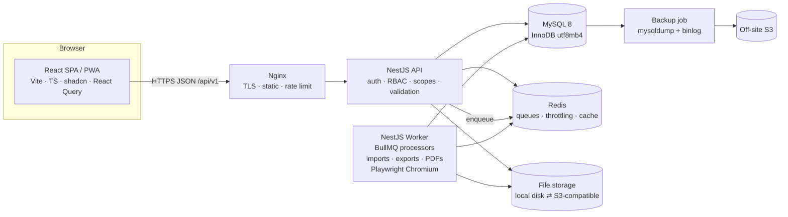

# 02 — System Architecture

Covers the system architecture, the project structure, **deliverable 14 (import/export architecture)**, PDF strategy, security, storage, deployment and backups.

---

## 1. Stack decisions

The stack follows the brief. Three choices are made where the brief left room or where there is a strong technical reason:

| Area | Choice | Reason |
|---|---|---|
| ORM / migrations | **Prisma** (MySQL 8) + raw-SQL migration steps where Prisma lacks support (CHECK constraints, generated columns) | Typed queries, reviewed migration files, mainstream. Raw `$queryRaw` for heavy reports |
| **PDF engine** | **HTML → PDF with headless Chromium (Playwright)** in the worker, fonts bundled (Noto Sans / Noto Sans Devanagari / Mukta) | Chromium shapes Devanagari through HarfBuzz, so conjuncts and matras (क्ष, त्र, श्री, ि placement) render correctly. pdfmake/PDFKit **do not shape Devanagari** and produce broken Hindi. The same HTML template drives the on-screen preview, giving a **WYSIWYG designer** |
| Excel | **ExcelJS** for reading and writing XLSX (styled templates, dropdown data-validation, cached formula results), **csv-parse/csv-stringify** for CSV | ExcelJS exposes `cell.result` for formula cells, which handles the Google `IMPORTRANGE` exports. The npm `xlsx` package is frozen at an old version with known advisories |
| Charts | Recharts | Composable, works with shadcn |
| Tables | TanStack Table (headless) + shadcn | Server-side pagination/sort/filter |
| Validation | **Zod schemas in a shared package**, used by React Hook Form *and* by NestJS pipes | One definition of a valid student, mark, etc. |
| Logging | pino (nestjs-pino), JSON, request-id correlation, redaction of secrets/PII | |
| Queue | BullMQ + Redis 7 | As per brief |
| i18n | react-i18next (en, hi; mr-ready) | |

## 2. High-level architecture



- **API** and **Worker** come from the same codebase with two entrypoints (`main.ts`, `worker.ts`), so domain services are shared and the processes scale independently.
- The worker never accepts HTTP traffic. PDF rendering CPU stays out of the API process.
- All long operations (imports > 500 rows, exports, bulk PDFs, report recomputation) run as **jobs**. The UI polls `GET /jobs/:id` (SSE upgrade later).

## 3. Repository structure (pnpm workspaces monorepo)

```
CPSAPP/
├─ apps/
│  ├─ api/                       NestJS (HTTP + worker entrypoints)
│  │  ├─ src/
│  │  │  ├─ main.ts              HTTP bootstrap
│  │  │  ├─ worker.ts            BullMQ bootstrap
│  │  │  ├─ common/              guards, interceptors, filters, pipes, decorators
│  │  │  │  ├─ auth/             JwtGuard, PermissionsGuard, @RequirePermission
│  │  │  │  ├─ scope/            AccessContext, ScopeService (assignment-based filters)
│  │  │  │  ├─ audit/            AuditService + interceptor
│  │  │  │  └─ errors/           ProblemDetails (RFC 9457) filter
│  │  │  ├─ infra/               prisma, redis, queue, storage, pdf (browser pool), excel, logger, config
│  │  │  └─ modules/
│  │  │     ├─ auth/  users/  roles/
│  │  │     ├─ school/  academic-years/  mediums/  standards/  classes/  subjects/  grading/  policies/  sequences/  calendar/
│  │  │     ├─ staff/  assignments/
│  │  │     ├─ students/  guardians/  enrollments/  promotions/  certificates/  data-quality/
│  │  │     ├─ attendance/
│  │  │     ├─ exams/  marks/  workflow/  results/
│  │  │     ├─ report-cards/  templates/  verification/
│  │  │     ├─ reports/  dashboard/
│  │  │     ├─ imports/  exports/  jobs/  files/
│  │  │     ├─ notifications/
│  │  │     └─ audit-logs/
│  │  ├─ prisma/  schema.prisma · migrations/ · seed/
│  │  └─ test/    e2e (supertest + Testcontainers MySQL/Redis)
│  └─ web/                       React + Vite
│     └─ src/
│        ├─ app/                 router, providers, layout (sidebar/topbar), auth
│        ├─ components/ui/       shadcn components
│        ├─ components/          DataTable, FilterBar, PageHeader, StatusBadge, ConfirmDialog, MarksGrid…
│        ├─ features/<module>/   pages, hooks (React Query), forms, columns
│        ├─ lib/                 api client, i18n, permissions (`can()`), formatters
│        └─ locales/ en/ hi/
├─ packages/
│  ├─ shared/                    Zod schemas, enums, permission codes, DTO types, error codes
│  ├─ domain/                    **pure TS business engines**: attendance calc, marks/grade/result calc,
│  │                             result-scheme resolver, workflow state machine, name heuristics
│  └─ report-templates/          HTML/CSS report-card & certificate renderers (shared by preview + PDF)
├─ infra/  docker-compose.yml · nginx.conf · backup scripts
├─ docs/
└─ .github/workflows/ci.yml      lint · typecheck · unit · e2e
```

**Why `packages/domain`:** the rules that must never be wrong (attendance %, grades, which exam columns are visible, workflow transitions) are pure functions with no DB access. They run under exhaustive unit tests, and the same code serves the API and the live preview in the template designer.

## 4. Backend module pattern

Each module has `controller → service → repository (Prisma)` with:
- **DTOs** from `@cps/shared` Zod schemas (`ZodValidationPipe`).
- **`@RequirePermission('marks.enter')`** on every handler, checked by the global `PermissionsGuard`.
- **`AccessContext`** injected per request: user, roles, permission set, and resolved data scope (school / medium / class / division / *assigned only*). Repositories **must** take the context and apply `scope.whereSection()`, etc. There is no "unscoped" repository method outside admin-only code paths.
- **Policy functions** for record-level checks: `canEditMarkSheet(ctx, sheet)` checks assignment, sheet status (not locked) and the deadline.
- **Transactions** (`prisma.$transaction`, isolation `READ COMMITTED` and `SELECT … FOR UPDATE` where needed) for: workflow transitions, mark-sheet save, attendance submit, promotion, sequence generation, import commit batches, publication.
- **Optimistic concurrency:** mutable aggregates (mark sheet, attendance session, student) carry `version`. Clients send `If-Match`/`version`, and a mismatch returns `409 CONFLICT` with the current state.
- **Audit:** services call `audit.record({action, entity, id, before, after, reason})` inside the same transaction. Bulk operations write one summary row plus row-level rows for marks/attendance changes after submission.

## 5. Frontend architecture

- **Routing:** React Router v6 data routes, with a lazily loaded route per feature. Route `handle.permission` hides inaccessible pages (UX only; the backend enforces).
- **Server state:** React Query with query keys `[module, filters]`, staleTime by data type, and optimistic updates only for the marks grid and attendance toggles.
- **Forms:** React Hook Form + `zodResolver(sharedSchema)`.
- **DataTable component:** server-driven `?page&pageSize&sort&filter[...]`, column visibility persisted per user, bulk selection → bulk actions, export button → creates an export job with the current filters.
- **MarksGrid:** virtualised rows; cell editor accepts numbers or `AB`/`EX`/`NA`; Enter/↓ moves down and Tab/→ moves across; red cell plus tooltip on validation error; autosave draft (debounced 2 s, batch PATCH); leaving with unsaved changes is blocked.
- **Context switcher:** academic year and medium are global, stored per user (`users.preferences`). Most pages default their filters to it.
- **PWA:** manifest and service worker for installability. Offline attendance draft is a later enhancement.

## 6. Background jobs

| Queue | Jobs | Concurrency | Notes |
|---|---|---|---|
| `imports` | `import.parse`, `import.validate`, `import.commit` | 2 | Commit in batches of 500 rows per transaction; idempotent per row |
| `exports` | `export.generate` | 2 | Streams rows (cursor pagination) → ExcelJS streaming writer |
| `pdf` | `reportcard.render`, `reportcard.bulk`, `certificate.render`, `report.pdf` | 2 per worker × browser pool 3 pages | Bulk job fans out child jobs per student, then a `zip` job |
| `results` | `results.compute` (on approval/publication) | 2 | Writes `student_results` snapshots |
| `maintenance` | backups trigger, export-file expiry, refresh-token cleanup | 1 | Repeatable jobs |
| `notifications` *(future)* | `outbox.dispatch` | 1 | WhatsApp provider adapter |

Every job row is mirrored in a `jobs` table (status, progress, result file, error) so the UI and history do not depend on Redis retention. Retries use exponential backoff, and permanently failed jobs are kept for inspection.

## 7. Security

| Control | Implementation |
|---|---|
| Passwords | **argon2id** (m=64MB, t=3), min length 8, breached-password list check, forced change on first login |
| Tokens | Access JWT (15 min, in memory; signed HS256 or EdDSA with key rotation via `kid`). Refresh token (opaque, 30 days) in an **httpOnly Secure SameSite=Strict cookie**, stored hashed, **rotated on use with reuse detection** (reuse revokes the whole family) |
| Brute force | `@nestjs/throttler` with Redis store: login 5/min per IP+username; account lock after 10 failures (15 min) |
| Authorization | RBAC (configurable permissions) **and** data scope (assignment-based). Both are enforced server-side on every endpoint |
| Input | Zod validation, Prisma parameterised queries, explicit allow-lists for sort/filter fields |
| Uploads | Size limits (XLSX/CSV 10 MB, images 2 MB, ZIP 50 MB); MIME **and magic-byte** checks; random storage keys; ZIP-bomb guard (entry count/ratio); images re-encoded with sharp (strips EXIF/scripts); never served from the API origin as HTML |
| Output | Strict CSP, `X-Content-Type-Options`, HSTS; CSV-injection protection (prefix `=+-@` cells with `'`) in exports |
| PII | Aadhaar encrypted with AES-256-GCM (app-level key from env/KMS) plus `aadhaar_last4` for display; caste/category behind `students.sensitive.read`; PII redacted in logs |
| Secrets | `.env` per environment (never committed); validated at boot with Zod; production via host secret store |
| Audit | Append-only `audit_logs`; the DB user for the app has no `UPDATE/DELETE` on it |
| Public verify | `/verify/:code` exposes only name initials, class, exam and result, with a rate limit |

## 8. Import / Export architecture (deliverable 14)

### 8.1 Import pipeline

```mermaid
sequenceDiagram
  participant U as User
  participant API
  participant Q as Queue
  participant W as Worker
  participant DB
  U->>API: POST /imports (file, type, year, medium)
  API->>DB: import_jobs(status=UPLOADED), file stored
  API->>Q: import.parse
  W->>DB: detect header row, sheets, columns → status=MAPPING_REQUIRED (+ suggested mapping)
  U->>API: PUT /imports/:id/mapping (or saved mapping auto-applied)
  API->>Q: import.validate
  W->>DB: import_job_rows (normalized, action, messages) → status=VALIDATED + summary
  U->>API: GET /imports/:id/rows?filter=invalid (preview)
  U->>API: POST /imports/:id/confirm (options: create-only | create+update)
  API->>Q: import.commit
  W->>DB: batches of 500 in transactions; per-row result → COMPLETED / COMPLETED_WITH_ERRORS
  U->>API: GET /imports/:id/error-report (XLSX: original row + messages)
```

**Importer framework:** each import type implements one interface, so adding a type (fees, library) means adding one class.

```ts
interface Importer<TRow> {
  type: ImportType;                       // 'students' | 'attendance_daily' | 'attendance_monthly' | 'marks' | ...
  fields: FieldDef[];                     // system fields, required flag, aliases (e.g. 'GR No.' → gr_no), parser
  contextSchema: ZodSchema;               // year/medium/exam/... required for this type
  normalize(raw, ctx): TRow | Issue[];    // trim, case, dates (Excel serial / dd/mm/yyyy), phones, enums, `--` placeholders
  match(rows, ctx): Promise<MatchResult[]>;  // existing record lookup → CREATE | UPDATE | NO_CHANGE | CONFLICT
  validateBatch(rows, ctx): Promise<Issue[]>; // cross-row (in-file duplicates) + DB rules (approved marks locked…)
  commit(batch, ctx, tx): Promise<RowResult[]>;
}
```

**Parsing rules (driven by the school's real files):**
- Read **cached values** of formula cells (Google `IMPORTRANGE` exports).
- **Header detection:** scan the first 30 rows for the row with the best alias-match score (e.g. row 7 in the Hindi list). Title rows above are captured as file metadata (e.g. `Medium: HINDI`, `Standard: X`) and cross-checked against the selected context, with a warning on mismatch.
- Ignore trailing blank rows, merged title cells, and footer rows ("Total Students on Roll").
- Multi-sheet workbooks: the user picks a sheet, or "all sheets with the same structure".
- Dates: Excel serials, `dd/mm/yyyy`, `dd-mm-yyyy`. **`mm/dd` is never assumed.**
- Phone numbers: digits only, strip `+91`/`0`, must be 10 digits starting 6–9.
- Exam No: apply the medium prefix if missing (`1001` + English → `E1001`).

**Data-protection rules (enforced in `validateBatch`/`commit`):**
- Never create a student if a **duplicate candidate** exists (same GR No, or the same normalised name + DOB, or the same School UID). The row becomes `DUPLICATE` and needs explicit resolution ("link to existing" / "create anyway" with the `students.import.force` permission).
- **Never overwrite** marks in a sheet that is `SUBMITTED` or later, or attendance in a `SUBMITTED`/locked session. Those rows are rejected with a reason.
- Updates require "create + update" mode plus the `*.import.update` permission. Changed fields are shown as a diff in the preview.
- An import never deletes anything.
- Re-running a failed import retries **only failed rows**. Each row has an idempotency key (`job_id + row_number`).
- Imported marks land as **DRAFT** in the mark sheet and still go through the approval workflow. *Exception:* historical-year migration mode (`migration.historical` permission, Super Admin only) can import marks as **APPROVED** with `source = MIGRATION`, a mandatory reason, and an audit entry. This is needed for 2025-26 history and possibly UT1 2026-27.

**Saved mappings:** `import_column_mappings` stores a header signature (hash of normalised headers) and the mapping. A matching file has its mapping auto-applied.

**Templates:** generated, not static. `GET /imports/templates/:type?classId=…&examId=…` produces an XLSX with:
- `Instructions` sheet (EN + HI): required fields, allowed values, date format, examples.
- `Data` sheet with header row, frozen panes, dropdown validation (gender, status, AB/EX/NA), example rows (greyed, auto-ignored if left).
- For marks/attendance: **pre-filled student roster** (Exam No, GR No, name) for the chosen division/exam/subject, with max marks shown in the header (`English (20)`). This is the safest way to round-trip through Google Sheets.
- Hidden `_meta` sheet with template type, version, and context IDs, so an uploaded template is recognised and validated against the right exam.

### 8.2 Export pipeline
`POST /exports {type, filters, format}` → `export_jobs` → worker streams DB rows (keyset pagination) → XLSX/CSV/PDF → storage → signed download URL (expires in 24 h). Small exports (< 2,000 rows) are synchronous streaming responses. Every export is audited (who exported what PII).

### 8.3 Future Google Sheets integration (designed, not built)
`DataSourceConnector` interface: `listSheets()`, `readRange()`, `writeRange()`. v1 ships only `UploadedFileConnector`. A later `GoogleSheetsConnector` (OAuth service account) plugs into the **same importer framework** (parse → map → validate → preview → confirm), so nothing downstream changes.

## 9. Future WhatsApp delivery (designed, not built)

Tables `message_templates`, `message_outbox`, `message_deliveries`, plus guardian `whatsapp_number` and `whatsapp_consent_at`. The `NotificationChannel` interface has a `WhatsAppCloudApiChannel` adapter (official Meta Cloud API or an approved BSP). The outbox pattern means publishing a report card enqueues messages transactionally. Delivery webhooks update status, and resend creates a new delivery row. Provider credentials live only in the secret store.

## 10. File storage

`StorageService` interface: `put(stream, {contentType, prefix}) → key`, `getStream(key)`, `signedUrl(key, ttl)`, `delete(key)`.
Drivers: `LocalDiskDriver` (dev, single-server prod), `S3Driver` (AWS S3 / Cloudflare R2 / MinIO). The `files` table holds metadata (sha256, size, mime, owner). The DB never stores file bytes.

Key layout: `schools/{id}/students/{studentId}/photo/{uuid}.jpg`, `.../imports/{jobId}/source.xlsx`, `.../report-cards/{publicationId}/{enrollmentId}-v{n}.pdf`.

## 11. Deployment

**Recommended v1 hosting:** one Linux VPS (4 vCPU / 8 GB, Mumbai region) with Docker Compose: `nginx`, `api` (×2), `worker` (×1), `mysql:8.4`, `redis:7`. Alternatively use managed MySQL plus a VPS for the app. This keeps cost low for one school while allowing growth.

Environments: `local` (Docker Compose), `staging` (same compose, anonymised data), `production`.
CI: GitHub Actions running lint, typecheck, unit tests, and e2e tests against MySQL/Redis service containers. Images are built per commit and deployed by tag.

## 12. Backup & recovery

| What | How | Retention |
|---|---|---|
| MySQL full | `mysqldump --single-transaction` nightly 01:00 IST, gzip + **encrypted** (age/GPG), upload off-site | 30 daily, 12 monthly |
| MySQL incremental | binlog shipping every 15 min | 7 days (point-in-time recovery) |
| Files | Nightly sync of storage to off-site bucket (versioned) | 30 days of versions |
| Verification | Monthly automated restore into a scratch DB + row-count checksum, with a report emailed to admin | |

A runbook (`docs/runbooks/restore.md`, Phase 8) gives exact restore steps.

## 13. Observability

pino JSON logs with request-id; `/health` (liveness) and `/ready` (DB + Redis) endpoints; a job-failure dashboard in-app (admin); optional Sentry for FE/BE errors (PII scrubbing on).
