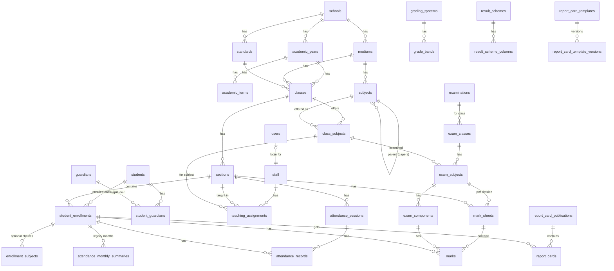

# 03 — Database Design

Covers **deliverables 5 (ERD), 6 (table definitions), 8 (student data model)**.
MySQL 8.0+/8.4 LTS · InnoDB · `utf8mb4` / `utf8mb4_0900_ai_ci` (full Devanagari support) · all timestamps `DATETIME(3)` in UTC · business dates `DATE` (IST calendar date).

## 0. Conventions

- **Standard columns** on every table unless noted. They are written as `/* std */` below:
  `id BIGINT UNSIGNED AUTO_INCREMENT PRIMARY KEY, created_at DATETIME(3) NOT NULL DEFAULT CURRENT_TIMESTAMP(3), updated_at DATETIME(3) NOT NULL DEFAULT CURRENT_TIMESTAMP(3) ON UPDATE CURRENT_TIMESTAMP(3), created_by BIGINT UNSIGNED NULL, updated_by BIGINT UNSIGNED NULL` (`created_by`/`updated_by` → `users.id`).
- Append-only tables (logs, history, workflow actions) have only `id, created_at, created_by`.
- `school_id` on top-level configuration and master tables, so a second branch or school can be added later without redesign.
- **No physical deletes** for anything referenced by history. `status` (`ACTIVE`/`INACTIVE`/…) is used instead. FKs are `ON DELETE RESTRICT` unless stated.
- Enums are stored as `VARCHAR(30)` with a `CHECK` constraint (easier migrations than MySQL `ENUM`), mirrored in `@cps/shared` enums.
- Money (future fees) `DECIMAL(12,2)`; marks `DECIMAL(6,2)`; percentages `DECIMAL(5,2)`.
- Mutable aggregates carry `version INT UNSIGNED NOT NULL DEFAULT 1` (optimistic locking).

## 1. ERD (core)



## 2. Student data model (deliverable 8)

```
students (permanent, one row per child for life)
 ├─ student_code  STU000001        system ID, never reused
 ├─ gr_no         SE-1510          admission/General Register no., unique per school
 ├─ school_uid    HIN20260000712   external ID as recorded (NOT unique-constrained, see findings)
 ├─ names: full_name_as_recorded + surname/first/father/mother (+ Hindi)
 ├─ guardians ←→ student_guardians (siblings share guardian rows)
 ├─ status history, documents, certificates
 └─ student_enrollments (one per academic year)
       2025-26 → EN / VIII / A / exam_no E818 / result PASS / PROMOTED
       2026-27 → EN / IX  / A / exam_no E9xx / ACTIVE
       └─ attendance_records, attendance_monthly_summaries, marks, student_results, report_cards
```

All academic facts (attendance, marks, results, report cards) attach to the **enrollment**, never directly to the student. Promotion creates a new enrollment, so history stays untouched and queryable.

## 3. Table definitions (deliverable 6)

### 3.1 School configuration

```sql
CREATE TABLE schools (
  /* std */,
  code VARCHAR(20) NOT NULL UNIQUE,
  name VARCHAR(200) NOT NULL,  name_hi VARCHAR(200) NULL,  motto VARCHAR(200) NULL,
  address_line VARCHAR(300) NOT NULL, city VARCHAR(80), state VARCHAR(80), pincode CHAR(6),
  phone VARCHAR(20), email VARCHAR(150), website VARCHAR(200),
  udise_code VARCHAR(20) NULL, registration_no VARCHAR(80) NULL, board VARCHAR(80) NULL,
  principal_name VARCHAR(150) NULL, principal_title VARCHAR(80) NULL,      -- "Head Mistress"
  logo_file_id BIGINT UNSIGNED NULL, stamp_file_id BIGINT UNSIGNED NULL, principal_sign_file_id BIGINT UNSIGNED NULL,
  timezone VARCHAR(40) NOT NULL DEFAULT 'Asia/Kolkata',
  status VARCHAR(20) NOT NULL DEFAULT 'ACTIVE'
);

CREATE TABLE files (
  /* std */, school_id BIGINT UNSIGNED NOT NULL,
  storage_driver VARCHAR(20) NOT NULL, storage_key VARCHAR(500) NOT NULL UNIQUE,
  original_name VARCHAR(255) NOT NULL, mime_type VARCHAR(100) NOT NULL,
  size_bytes BIGINT UNSIGNED NOT NULL, sha256 CHAR(64) NOT NULL,
  purpose VARCHAR(40) NOT NULL,             -- STUDENT_PHOTO, IMPORT_SOURCE, REPORT_CARD_PDF, EXPORT, LOGO …
  expires_at DATETIME(3) NULL,
  INDEX ix_files_purpose (school_id, purpose)
);

CREATE TABLE academic_years (
  /* std */, school_id BIGINT UNSIGNED NOT NULL,
  name VARCHAR(20) NOT NULL,                -- '2026-27'
  start_date DATE NOT NULL, end_date DATE NOT NULL,
  weekly_off_days JSON NOT NULL,            -- e.g. [0] = Sunday; supports [0,6]
  status VARCHAR(20) NOT NULL DEFAULT 'PLANNED',   -- PLANNED | ACTIVE | CLOSED
  is_current BOOLEAN NOT NULL DEFAULT FALSE,
  current_flag TINYINT GENERATED ALWAYS AS (IF(is_current, 1, NULL)) STORED,
  closed_at DATETIME(3) NULL, closed_by BIGINT UNSIGNED NULL,
  UNIQUE KEY uq_year_name (school_id, name),
  UNIQUE KEY uq_one_current (school_id, current_flag),
  CHECK (end_date > start_date)
);

CREATE TABLE academic_terms (           -- Semester I / II (attendance grouping, report columns)
  /* std */, academic_year_id BIGINT UNSIGNED NOT NULL,
  code VARCHAR(20) NOT NULL, name_en VARCHAR(80) NOT NULL, name_hi VARCHAR(80) NULL,
  start_date DATE NOT NULL, end_date DATE NOT NULL, sequence TINYINT NOT NULL,
  UNIQUE KEY uq_term (academic_year_id, code)
);

CREATE TABLE mediums (
  /* std */, school_id BIGINT UNSIGNED NOT NULL,
  code VARCHAR(10) NOT NULL,                -- 'EN', 'HI'
  name_en VARCHAR(60) NOT NULL, name_hi VARCHAR(60) NULL,
  exam_no_prefix VARCHAR(5) NULL,           -- 'E', 'H'
  sort_order SMALLINT NOT NULL DEFAULT 0, status VARCHAR(20) NOT NULL DEFAULT 'ACTIVE',
  UNIQUE KEY uq_medium (school_id, code)
);

CREATE TABLE standards (                -- grade levels: Nursery, LKG, UKG, I … X
  /* std */, school_id BIGINT UNSIGNED NOT NULL,
  code VARCHAR(10) NOT NULL, name_en VARCHAR(40) NOT NULL, name_hi VARCHAR(40) NULL,
  level_order SMALLINT NOT NULL,            -- used for promotion (next = level_order + 1)
  status VARCHAR(20) NOT NULL DEFAULT 'ACTIVE',
  UNIQUE KEY uq_std (school_id, code)
);

CREATE TABLE classes (                  -- standard × medium × year
  /* std */, academic_year_id BIGINT UNSIGNED NOT NULL, medium_id BIGINT UNSIGNED NOT NULL,
  standard_id BIGINT UNSIGNED NOT NULL,
  code VARCHAR(30) NOT NULL,                -- 'EN-X'
  display_name VARCHAR(60) NOT NULL,        -- 'ENGLISH-X'
  grading_system_id BIGINT UNSIGNED NULL,   -- default for subjects
  status VARCHAR(20) NOT NULL DEFAULT 'ACTIVE',
  UNIQUE KEY uq_class (academic_year_id, medium_id, standard_id),
  INDEX ix_class_medium (medium_id, academic_year_id)
);

CREATE TABLE sections (                 -- divisions A, B …
  /* std */, class_id BIGINT UNSIGNED NOT NULL,
  name VARCHAR(10) NOT NULL, capacity SMALLINT UNSIGNED NULL, room VARCHAR(30) NULL,
  status VARCHAR(20) NOT NULL DEFAULT 'ACTIVE',
  UNIQUE KEY uq_section (class_id, name)
);

CREATE TABLE subjects (                 -- catalog per medium; papers via parent_subject_id
  /* std */, school_id BIGINT UNSIGNED NOT NULL, medium_id BIGINT UNSIGNED NOT NULL,
  code VARCHAR(20) NOT NULL, name_en VARCHAR(100) NOT NULL, name_hi VARCHAR(100) NULL,
  short_name VARCHAR(20) NULL,              -- 'Geom.', 'Sci-I'
  subject_type VARCHAR(20) NOT NULL,        -- THEORY | PRACTICAL | ORAL | ACTIVITY | OTHER
  area VARCHAR(20) NOT NULL DEFAULT 'SCHOLASTIC',  -- SCHOLASTIC | CO_SCHOLASTIC
  parent_subject_id BIGINT UNSIGNED NULL,   -- Algebra → Mathematics
  status VARCHAR(20) NOT NULL DEFAULT 'ACTIVE',
  UNIQUE KEY uq_subject (medium_id, code)
);

CREATE TABLE class_subjects (
  /* std */, class_id BIGINT UNSIGNED NOT NULL, subject_id BIGINT UNSIGNED NOT NULL,
  is_optional BOOLEAN NOT NULL DEFAULT FALSE, optional_group VARCHAR(30) NULL,
  include_in_total BOOLEAN NOT NULL DEFAULT TRUE,
  default_max_marks DECIMAL(6,2) NULL, default_pass_marks DECIMAL(6,2) NULL,
  grading_system_id BIGINT UNSIGNED NULL,
  report_rollup VARCHAR(20) NOT NULL DEFAULT 'SELF',  -- SELF | INTO_PARENT (papers summed under parent row) | BOTH
  display_order SMALLINT NOT NULL DEFAULT 0,
  status VARCHAR(20) NOT NULL DEFAULT 'ACTIVE',
  UNIQUE KEY uq_class_subject (class_id, subject_id)
);

CREATE TABLE grading_systems (
  /* std */, school_id BIGINT UNSIGNED NOT NULL,
  name VARCHAR(80) NOT NULL,                -- 'Maharashtra CCE 9-point'
  basis VARCHAR(20) NOT NULL DEFAULT 'PERCENT',
  status VARCHAR(20) NOT NULL DEFAULT 'ACTIVE'
);

CREATE TABLE grade_bands (
  /* std */, grading_system_id BIGINT UNSIGNED NOT NULL,
  grade VARCHAR(5) NOT NULL, min_percent DECIMAL(5,2) NOT NULL, max_percent DECIMAL(5,2) NOT NULL,
  grade_point DECIMAL(4,2) NULL, label_en VARCHAR(60) NULL, label_hi VARCHAR(60) NULL,
  is_pass BOOLEAN NOT NULL, sort_order TINYINT NOT NULL,
  UNIQUE KEY uq_band (grading_system_id, grade),
  CHECK (min_percent <= max_percent)
);  -- service validates bands are contiguous & non-overlapping 0–100

CREATE TABLE policies (                 -- scoped configuration, most specific wins
  /* std */, school_id BIGINT UNSIGNED NOT NULL,
  academic_year_id BIGINT UNSIGNED NULL, medium_id BIGINT UNSIGNED NULL,
  standard_id BIGINT UNSIGNED NULL, class_id BIGINT UNSIGNED NULL,
  policy_key VARCHAR(60) NOT NULL,          -- attendance.half_day_weight, marks.absent_policy, result.pass_percent_subject …
  value JSON NOT NULL,
  scope_key VARCHAR(120) GENERATED ALWAYS AS (CONCAT_WS(':', IFNULL(academic_year_id,'*'), IFNULL(medium_id,'*'), IFNULL(standard_id,'*'), IFNULL(class_id,'*'))) STORED,
  UNIQUE KEY uq_policy (school_id, policy_key, scope_key)
);

CREATE TABLE number_sequences (
  /* std */, school_id BIGINT UNSIGNED NOT NULL,
  seq_key VARCHAR(60) NOT NULL,             -- 'student_code', 'gr_no', 'exam_no:2026-27:EN', 'lc_serial:2026-27'
  pattern VARCHAR(60) NOT NULL,             -- 'STU{000000}', 'SE-{0000}', 'E{0000}'
  next_value BIGINT UNSIGNED NOT NULL,
  UNIQUE KEY uq_seq (school_id, seq_key)
);  -- allocated with SELECT … FOR UPDATE inside the creating transaction

CREATE TABLE calendar_events (
  /* std */, academic_year_id BIGINT UNSIGNED NOT NULL,
  event_type VARCHAR(30) NOT NULL,          -- HOLIDAY | VACATION | EXAM_HOLIDAY | SPECIAL_WORKING_DAY | EVENT
  title_en VARCHAR(150) NOT NULL, title_hi VARCHAR(150) NULL,
  start_date DATE NOT NULL, end_date DATE NOT NULL,
  medium_id BIGINT UNSIGNED NULL, standard_id BIGINT UNSIGNED NULL, section_id BIGINT UNSIGNED NULL,  -- NULL = all
  INDEX ix_cal (academic_year_id, start_date, end_date)
);
```

### 3.2 Students

```sql
CREATE TABLE students (
  /* std */, version INT UNSIGNED NOT NULL DEFAULT 1, school_id BIGINT UNSIGNED NOT NULL,
  student_code VARCHAR(20) NOT NULL,        -- STU000001 permanent
  gr_no VARCHAR(30) NOT NULL,               -- admission / General Register no.
  school_uid VARCHAR(40) NULL,              -- as recorded in school sheets
  pen VARCHAR(20) NULL, apaar_id VARCHAR(20) NULL, saral_id VARCHAR(30) NULL,
  aadhaar_enc VARBINARY(128) NULL, aadhaar_last4 CHAR(4) NULL, aadhaar_hash CHAR(64) NULL,  -- hash (HMAC) for duplicate detection
  full_name_as_recorded VARCHAR(250) NOT NULL,         -- 'BENVANSHI KOMAL RAJU REKHA DEVI'
  surname VARCHAR(80) NULL, first_name VARCHAR(80) NULL, father_name VARCHAR(120) NULL, mother_name VARCHAR(120) NULL,
  name_split_verified BOOLEAN NOT NULL DEFAULT FALSE,
  full_name_hi VARCHAR(250) NULL,
  name_normalized VARCHAR(250) GENERATED ALWAYS AS (UPPER(REGEXP_REPLACE(full_name_as_recorded, '[^A-Za-z ]', ''))) STORED,
  dob DATE NULL, gender VARCHAR(10) NOT NULL,          -- MALE | FEMALE | OTHER
  birth_place VARCHAR(100) NULL, nationality VARCHAR(40) NULL DEFAULT 'Indian',
  religion VARCHAR(40) NULL, category VARCHAR(30) NULL, caste VARCHAR(80) NULL,  -- sensitive
  mother_tongue VARCHAR(40) NULL, blood_group VARCHAR(5) NULL,
  email VARCHAR(150) NULL,
  address_line VARCHAR(300) NULL, city VARCHAR(80) NULL, state VARCHAR(80) NULL, pincode CHAR(6) NULL,
  admission_date DATE NULL, admission_standard_id BIGINT UNSIGNED NULL, previous_school VARCHAR(200) NULL,
  photo_file_id BIGINT UNSIGNED NULL,
  status VARCHAR(20) NOT NULL DEFAULT 'ACTIVE',  -- ACTIVE | WITHDRAWN | TRANSFERRED | PASSED_OUT | INACTIVE
  notes TEXT NULL,
  UNIQUE KEY uq_student_code (school_id, student_code),
  UNIQUE KEY uq_gr (school_id, gr_no),
  INDEX ix_student_name (school_id, name_normalized),
  INDEX ix_student_dob (school_id, dob),
  INDEX ix_school_uid (school_id, school_uid),
  INDEX ix_aadhaar_hash (school_id, aadhaar_hash),
  FULLTEXT KEY ft_student_name (full_name_as_recorded, full_name_hi) WITH PARSER ngram
);

CREATE TABLE guardians (
  /* std */, school_id BIGINT UNSIGNED NOT NULL,
  name VARCHAR(150) NOT NULL, name_hi VARCHAR(150) NULL,
  mobile CHAR(10) NULL, alt_mobile CHAR(10) NULL,
  whatsapp_number VARCHAR(15) NULL, whatsapp_consent_at DATETIME(3) NULL,
  email VARCHAR(150) NULL, occupation VARCHAR(100) NULL, address_line VARCHAR(300) NULL,
  INDEX ix_guardian_mobile (school_id, mobile)
);

CREATE TABLE student_guardians (
  /* std */, student_id BIGINT UNSIGNED NOT NULL, guardian_id BIGINT UNSIGNED NOT NULL,
  relation VARCHAR(20) NOT NULL,            -- FATHER | MOTHER | GUARDIAN | OTHER
  is_primary BOOLEAN NOT NULL DEFAULT FALSE,
  UNIQUE KEY uq_sg (student_id, guardian_id)
);

CREATE TABLE student_enrollments (
  /* std */, version INT UNSIGNED NOT NULL DEFAULT 1,
  student_id BIGINT UNSIGNED NOT NULL, academic_year_id BIGINT UNSIGNED NOT NULL,
  class_id BIGINT UNSIGNED NOT NULL, section_id BIGINT UNSIGNED NOT NULL,
  medium_id BIGINT UNSIGNED NOT NULL,       -- denormalised from class for fast filtering (kept consistent by service)
  roll_no SMALLINT UNSIGNED NULL, exam_no VARCHAR(20) NULL,
  joined_on DATE NOT NULL, left_on DATE NULL,
  status VARCHAR(20) NOT NULL DEFAULT 'ACTIVE',  -- ACTIVE | PROMOTED | DETAINED | COMPLETED | TRANSFERRED_OUT | WITHDRAWN
  final_result VARCHAR(20) NULL,            -- PASS | FAIL | PROMOTED | DETAINED (filled at year end)
  promoted_to_enrollment_id BIGINT UNSIGNED NULL,
  UNIQUE KEY uq_enr_year (student_id, academic_year_id),
  UNIQUE KEY uq_enr_examno (academic_year_id, exam_no),
  UNIQUE KEY uq_enr_roll (section_id, roll_no),
  INDEX ix_enr_section (section_id, status),
  INDEX ix_enr_class (class_id, status),
  INDEX ix_enr_medium (academic_year_id, medium_id, status)
);

CREATE TABLE enrollment_section_changes (   -- mid-year division change, append-only
  id, created_at, created_by, enrollment_id BIGINT UNSIGNED NOT NULL,
  from_section_id BIGINT UNSIGNED NOT NULL, to_section_id BIGINT UNSIGNED NOT NULL,
  effective_date DATE NOT NULL, reason VARCHAR(300) NOT NULL
);

CREATE TABLE enrollment_subjects (          -- chosen optional subjects
  /* std */, enrollment_id BIGINT UNSIGNED NOT NULL, class_subject_id BIGINT UNSIGNED NOT NULL,
  UNIQUE KEY uq_es (enrollment_id, class_subject_id)
);

CREATE TABLE student_status_history (       -- append-only
  id, created_at, created_by, student_id BIGINT UNSIGNED NOT NULL,
  from_status VARCHAR(20) NULL, to_status VARCHAR(20) NOT NULL,
  effective_date DATE NOT NULL, reason VARCHAR(500) NOT NULL,
  INDEX ix_ssh (student_id, created_at)
);

CREATE TABLE student_documents (
  /* std */, student_id BIGINT UNSIGNED NOT NULL, doc_type VARCHAR(40) NOT NULL,
  file_id BIGINT UNSIGNED NOT NULL, verified_by BIGINT UNSIGNED NULL, verified_at DATETIME(3) NULL,
  INDEX ix_sd (student_id)
);

CREATE TABLE certificates (                 -- LC, Bonafide, ID card
  /* std */, school_id BIGINT UNSIGNED NOT NULL, student_id BIGINT UNSIGNED NOT NULL,
  cert_type VARCHAR(20) NOT NULL, serial_no VARCHAR(30) NOT NULL,
  issued_on DATE NOT NULL, data_snapshot JSON NOT NULL, file_id BIGINT UNSIGNED NULL,
  verification_code CHAR(12) NOT NULL UNIQUE,
  status VARCHAR(20) NOT NULL DEFAULT 'ISSUED',  -- ISSUED | CANCELLED | REISSUED
  cancel_reason VARCHAR(300) NULL, replaces_certificate_id BIGINT UNSIGNED NULL,
  UNIQUE KEY uq_cert_serial (school_id, cert_type, serial_no)
);
```

### 3.3 Staff & assignments

```sql
CREATE TABLE staff (
  /* std */, school_id BIGINT UNSIGNED NOT NULL,
  employee_code VARCHAR(20) NOT NULL, name VARCHAR(150) NOT NULL, name_hi VARCHAR(150) NULL,
  photo_file_id BIGINT UNSIGNED NULL, mobile CHAR(10) NULL, email VARCHAR(150) NULL, address_line VARCHAR(300) NULL,
  joining_date DATE NULL, designation VARCHAR(60) NULL, employment_type VARCHAR(20) NULL,
  status VARCHAR(20) NOT NULL DEFAULT 'ACTIVE',
  UNIQUE KEY uq_emp (school_id, employee_code)
);

CREATE TABLE teaching_assignments (         -- replaces teacher_assignments / *_class_ / *_subject_ tables
  /* std */, academic_year_id BIGINT UNSIGNED NOT NULL, staff_id BIGINT UNSIGNED NOT NULL,
  role VARCHAR(20) NOT NULL,                -- SUBJECT_TEACHER | CLASS_TEACHER | ATTENDANCE_TEACHER
  section_id BIGINT UNSIGNED NOT NULL, class_subject_id BIGINT UNSIGNED NULL,  -- required for SUBJECT_TEACHER
  valid_from DATE NOT NULL, valid_to DATE NULL,
  status VARCHAR(20) NOT NULL DEFAULT 'ACTIVE',
  ct_key BIGINT UNSIGNED GENERATED ALWAYS AS (IF(role='CLASS_TEACHER' AND status='ACTIVE', section_id, NULL)) STORED,
  UNIQUE KEY uq_one_class_teacher (ct_key),
  UNIQUE KEY uq_assign (staff_id, role, section_id, class_subject_id, valid_from),
  INDEX ix_ta_staff (staff_id, academic_year_id, status),
  INDEX ix_ta_section (section_id, role, status),
  CHECK (role <> 'SUBJECT_TEACHER' OR class_subject_id IS NOT NULL)
);
```

### 3.4 Attendance

```sql
CREATE TABLE attendance_sessions (
  /* std */, version INT UNSIGNED NOT NULL DEFAULT 1,
  section_id BIGINT UNSIGNED NOT NULL, att_date DATE NOT NULL,
  session_code VARCHAR(10) NOT NULL DEFAULT 'DAY',   -- DAY | AM | PM (multi-session ready)
  status VARCHAR(20) NOT NULL DEFAULT 'DRAFT',       -- DRAFT | SUBMITTED | VERIFIED | LOCKED
  marked_by BIGINT UNSIGNED NULL, submitted_at DATETIME(3) NULL,
  verified_by BIGINT UNSIGNED NULL, verified_at DATETIME(3) NULL,
  UNIQUE KEY uq_att_session (section_id, att_date, session_code),
  INDEX ix_att_date (att_date, status)
);

CREATE TABLE attendance_records (
  /* std */, session_id BIGINT UNSIGNED NOT NULL, enrollment_id BIGINT UNSIGNED NOT NULL,
  status CHAR(1) NOT NULL,                  -- P | A | L | H
  remark VARCHAR(200) NULL,
  UNIQUE KEY uq_att_rec (session_id, enrollment_id),
  INDEX ix_att_enr (enrollment_id, session_id),
  CHECK (status IN ('P','A','L','H'))
);

CREATE TABLE attendance_corrections (
  /* std */, record_id BIGINT UNSIGNED NOT NULL,
  old_status CHAR(1) NOT NULL, new_status CHAR(1) NOT NULL, reason VARCHAR(500) NOT NULL,
  status VARCHAR(20) NOT NULL DEFAULT 'PENDING',     -- PENDING | APPROVED | REJECTED
  reviewed_by BIGINT UNSIGNED NULL, reviewed_at DATETIME(3) NULL, review_comment VARCHAR(500) NULL,
  INDEX ix_corr_status (status, created_at)
);

CREATE TABLE attendance_monthly_summaries (     -- legacy / pre-go-live months (the school's current format)
  /* std */, enrollment_id BIGINT UNSIGNED NOT NULL,
  year_month CHAR(7) NOT NULL,              -- '2026-07'
  working_days DECIMAL(5,1) NOT NULL, present_days DECIMAL(5,1) NOT NULL,
  absent_days DECIMAL(5,1) NULL, leave_days DECIMAL(5,1) NULL, half_days DECIMAL(5,1) NULL,
  source VARCHAR(20) NOT NULL,              -- IMPORT | MANUAL
  import_job_id BIGINT UNSIGNED NULL,
  status VARCHAR(20) NOT NULL DEFAULT 'DRAFT',       -- DRAFT | APPROVED
  approved_by BIGINT UNSIGNED NULL, approved_at DATETIME(3) NULL,
  UNIQUE KEY uq_ams (enrollment_id, year_month),
  CHECK (present_days <= working_days)
);
```

### 3.5 Examinations, marks, workflow

```sql
CREATE TABLE examinations (
  /* std */, academic_year_id BIGINT UNSIGNED NOT NULL, medium_id BIGINT UNSIGNED NOT NULL,
  code VARCHAR(20) NOT NULL, name_en VARCHAR(100) NOT NULL, name_hi VARCHAR(100) NULL,
  exam_kind VARCHAR(20) NOT NULL,           -- UNIT_TEST | SEMESTER | TERM | ANNUAL | PRACTICAL | ORAL | OTHER
  term_id BIGINT UNSIGNED NULL, start_date DATE NULL, end_date DATE NULL,
  marks_due_date DATE NULL, sequence SMALLINT NOT NULL DEFAULT 0,
  status VARCHAR(30) NOT NULL DEFAULT 'DRAFT',  -- DRAFT | SCHEDULED | CONDUCTED | MARKS_ENTRY | CLOSED (overall)
  UNIQUE KEY uq_exam (academic_year_id, medium_id, code)
);

CREATE TABLE exam_classes (                 -- per-class workflow status
  /* std */, version INT UNSIGNED NOT NULL DEFAULT 1,
  examination_id BIGINT UNSIGNED NOT NULL, class_id BIGINT UNSIGNED NOT NULL,
  applicable_section_ids JSON NULL,         -- NULL = all divisions
  status VARCHAR(30) NOT NULL DEFAULT 'DRAFT',
    -- DRAFT | SCHEDULED | CONDUCTED | MARKS_ENTRY | SUBMITTED_FOR_VERIFICATION | VERIFIED | APPROVED | PUBLISHED
  approved_by BIGINT UNSIGNED NULL, approved_at DATETIME(3) NULL,
  published_by BIGINT UNSIGNED NULL, published_at DATETIME(3) NULL,
  UNIQUE KEY uq_exam_class (examination_id, class_id),
  INDEX ix_ec_status (class_id, status)
);

CREATE TABLE exam_subjects (
  /* std */, exam_class_id BIGINT UNSIGNED NOT NULL, class_subject_id BIGINT UNSIGNED NOT NULL,
  exam_date DATE NULL, start_time TIME NULL, duration_min SMALLINT NULL,
  max_marks DECIMAL(6,2) NOT NULL,          -- = sum of component max
  pass_marks DECIMAL(6,2) NULL,             -- NULL → policy result.pass_percent_subject
  grading_system_id BIGINT UNSIGNED NULL,
  grade_only BOOLEAN NOT NULL DEFAULT FALSE,
  UNIQUE KEY uq_exam_subject (exam_class_id, class_subject_id)
);

CREATE TABLE exam_components (              -- FORMATIVE 40 / SUMMATIVE 60 / THEORY / PRACTICAL / ORAL
  /* std */, exam_subject_id BIGINT UNSIGNED NOT NULL,
  code VARCHAR(20) NOT NULL, label_en VARCHAR(40) NOT NULL, label_hi VARCHAR(40) NULL,
  max_marks DECIMAL(6,2) NOT NULL, pass_marks DECIMAL(6,2) NULL,
  entry_mode VARCHAR(10) NOT NULL DEFAULT 'ENTERED',   -- ENTERED | DERIVED
  derivation JSON NULL,   -- {"op":"SUM","sources":[{"examCode":"UT1"},{"examCode":"UT2"}],"scaleTo":40}
  sort_order TINYINT NOT NULL DEFAULT 0,
  UNIQUE KEY uq_comp (exam_subject_id, code),
  CHECK (max_marks > 0)
);

CREATE TABLE mark_sheets (                  -- unit of entry & submission: exam-subject × division
  /* std */, version INT UNSIGNED NOT NULL DEFAULT 1,
  exam_subject_id BIGINT UNSIGNED NOT NULL, section_id BIGINT UNSIGNED NOT NULL,
  status VARCHAR(30) NOT NULL DEFAULT 'NOT_STARTED',
    -- NOT_STARTED | DRAFT | SUBMITTED | CLASS_VERIFIED | COORD_VERIFIED | APPROVED | REJECTED | REOPENED
  is_locked BOOLEAN NOT NULL DEFAULT FALSE,
  source VARCHAR(20) NOT NULL DEFAULT 'ENTRY',        -- ENTRY | IMPORT | MIGRATION
  entered_by BIGINT UNSIGNED NULL, submitted_by BIGINT UNSIGNED NULL, submitted_at DATETIME(3) NULL,
  last_rejection_comment VARCHAR(1000) NULL,
  UNIQUE KEY uq_mark_sheet (exam_subject_id, section_id),
  INDEX ix_ms_status (status)
);

CREATE TABLE marks (
  /* std */, mark_sheet_id BIGINT UNSIGNED NOT NULL, component_id BIGINT UNSIGNED NOT NULL,
  enrollment_id BIGINT UNSIGNED NOT NULL,
  mark_status VARCHAR(5) NOT NULL DEFAULT 'P',        -- P (present) | AB | EX (exempted) | NA | ML (medical)
  marks_obtained DECIMAL(6,2) NULL,
  grace_marks DECIMAL(5,2) NOT NULL DEFAULT 0,
  remarks VARCHAR(200) NULL,
  UNIQUE KEY uq_mark (component_id, enrollment_id),
  INDEX ix_marks_enr (enrollment_id),
  INDEX ix_marks_sheet (mark_sheet_id),
  CHECK ((mark_status = 'P') = (marks_obtained IS NOT NULL)),
  CHECK (marks_obtained IS NULL OR marks_obtained >= 0)
);   -- upper bound (≤ component max) validated in service; trigger optional

CREATE TABLE mark_revisions (               -- append-only, every change after first submission
  id, created_at, created_by, mark_id BIGINT UNSIGNED NOT NULL,
  old_status VARCHAR(5), old_marks DECIMAL(6,2), new_status VARCHAR(5), new_marks DECIMAL(6,2),
  sheet_status_at_change VARCHAR(30) NOT NULL, reason VARCHAR(500) NULL,
  INDEX ix_mr (mark_id)
);

CREATE TABLE section_exam_reviews (         -- class-teacher verification unit
  /* std */, exam_class_id BIGINT UNSIGNED NOT NULL, section_id BIGINT UNSIGNED NOT NULL,
  status VARCHAR(20) NOT NULL DEFAULT 'PENDING',     -- PENDING | VERIFIED | RETURNED
  verified_by BIGINT UNSIGNED NULL, verified_at DATETIME(3) NULL,
  UNIQUE KEY uq_ser (exam_class_id, section_id)
);

CREATE TABLE workflow_actions (             -- approval log for every workflow entity (append-only)
  id, created_at, created_by,
  entity_type VARCHAR(30) NOT NULL,         -- MARK_SHEET | SECTION_REVIEW | EXAM_CLASS | ATTENDANCE_SESSION | ATT_CORRECTION | PUBLICATION
  entity_id BIGINT UNSIGNED NOT NULL,
  action VARCHAR(20) NOT NULL,              -- SUBMIT | VERIFY | APPROVE | REJECT | REOPEN | PUBLISH | REVOKE
  from_status VARCHAR(30) NOT NULL, to_status VARCHAR(30) NOT NULL,
  stage VARCHAR(30) NULL, comment VARCHAR(1000) NULL,
  INDEX ix_wf (entity_type, entity_id, created_at)
);

CREATE TABLE student_term_assessments (     -- remarks, conduct, progress, co-curricular (per enrollment per term/scheme)
  /* std */, enrollment_id BIGINT UNSIGNED NOT NULL, term_id BIGINT UNSIGNED NOT NULL,
  conduct VARCHAR(40) NULL, progress VARCHAR(40) NULL,
  class_teacher_remark VARCHAR(500) NULL, principal_remark VARCHAR(500) NULL,
  co_curricular JSON NULL, status VARCHAR(20) NOT NULL DEFAULT 'DRAFT',
  UNIQUE KEY uq_sta (enrollment_id, term_id)
);

CREATE TABLE remark_bank (
  /* std */, school_id BIGINT UNSIGNED NOT NULL, category VARCHAR(30) NOT NULL,
  text_en VARCHAR(300) NOT NULL, text_hi VARCHAR(300) NULL, status VARCHAR(20) NOT NULL DEFAULT 'ACTIVE'
);
```

### 3.6 Results & report cards

```sql
CREATE TABLE result_schemes (               -- which columns a report card has, per class
  /* std */, academic_year_id BIGINT UNSIGNED NOT NULL, class_id BIGINT UNSIGNED NOT NULL,
  name VARCHAR(100) NOT NULL, status VARCHAR(20) NOT NULL DEFAULT 'ACTIVE',
  UNIQUE KEY uq_rs (class_id, name)
);

CREATE TABLE result_scheme_columns (
  /* std */, scheme_id BIGINT UNSIGNED NOT NULL,
  column_key VARCHAR(30) NOT NULL,          -- 'SEM1', 'SEM2', 'AVG'
  column_type VARCHAR(10) NOT NULL,         -- EXAM | AGGREGATE
  examination_id BIGINT UNSIGNED NULL,      -- for EXAM
  aggregate JSON NULL,                      -- {"op":"AVERAGE","inputs":["SEM1","SEM2"],"round":"HALF_UP_INT","requireAllInputs":true}
  label_en VARCHAR(60) NOT NULL, label_hi VARCHAR(60) NULL,
  show_components BOOLEAN NOT NULL DEFAULT TRUE, show_total BOOLEAN NOT NULL DEFAULT TRUE, show_grade BOOLEAN NOT NULL DEFAULT TRUE,
  is_final BOOLEAN NOT NULL DEFAULT FALSE,  -- drives Result / Percentage / Overall grade
  sort_order TINYINT NOT NULL,
  UNIQUE KEY uq_rsc (scheme_id, column_key)
);

CREATE TABLE report_card_templates (
  /* std */, school_id BIGINT UNSIGNED NOT NULL, name VARCHAR(100) NOT NULL,
  medium_id BIGINT UNSIGNED NULL, standard_id BIGINT UNSIGNED NULL,   -- applicability (NULL = any)
  current_version_id BIGINT UNSIGNED NULL, status VARCHAR(20) NOT NULL DEFAULT 'ACTIVE'
);

CREATE TABLE report_card_template_versions (    -- immutable once used by a publication
  id, created_at, created_by, template_id BIGINT UNSIGNED NOT NULL, version_no INT NOT NULL,
  layout JSON NOT NULL,                     -- page, margins, fonts, ordered sections + options + EN/HI labels
  UNIQUE KEY uq_tv (template_id, version_no)
);

CREATE TABLE report_card_publications (
  /* std */, academic_year_id BIGINT UNSIGNED NOT NULL, class_id BIGINT UNSIGNED NOT NULL,
  section_id BIGINT UNSIGNED NULL,          -- NULL = whole class
  scheme_id BIGINT UNSIGNED NOT NULL, template_version_id BIGINT UNSIGNED NOT NULL,
  title VARCHAR(100) NOT NULL,              -- 'Semester I Progress Report'
  visible_columns JSON NOT NULL,            -- frozen list of column keys at publish time
  issue_date DATE NOT NULL, reopening_date DATE NULL,
  status VARCHAR(20) NOT NULL DEFAULT 'DRAFT',       -- DRAFT | PUBLISHED | SUPERSEDED | REVOKED
  published_by BIGINT UNSIGNED NULL, published_at DATETIME(3) NULL,
  supersedes_id BIGINT UNSIGNED NULL, revoke_reason VARCHAR(500) NULL,
  INDEX ix_pub (class_id, status)
);

CREATE TABLE student_results (              -- computed snapshot, frozen with the publication
  /* std */, publication_id BIGINT UNSIGNED NOT NULL, enrollment_id BIGINT UNSIGNED NOT NULL,
  total_obtained DECIMAL(8,2) NULL, total_max DECIMAL(8,2) NULL, percentage DECIMAL(5,2) NULL,
  grade VARCHAR(5) NULL, result VARCHAR(20) NULL,     -- PASS | FAIL | INCOMPLETE | PROMOTED
  rank_in_section SMALLINT NULL, rank_in_class SMALLINT NULL,
  detail JSON NOT NULL,                     -- per-subject per-column values, attendance table, remarks (render input)
  UNIQUE KEY uq_sr (publication_id, enrollment_id)
);

CREATE TABLE report_cards (
  /* std */, publication_id BIGINT UNSIGNED NOT NULL, enrollment_id BIGINT UNSIGNED NOT NULL,
  student_result_id BIGINT UNSIGNED NOT NULL, file_id BIGINT UNSIGNED NULL,
  verification_code CHAR(12) NOT NULL UNIQUE, render_status VARCHAR(20) NOT NULL DEFAULT 'PENDING',
  generated_at DATETIME(3) NULL, print_count INT UNSIGNED NOT NULL DEFAULT 0,
  UNIQUE KEY uq_rc (publication_id, enrollment_id)
);
```

### 3.7 Security & audit

```sql
CREATE TABLE users (
  /* std */, school_id BIGINT UNSIGNED NOT NULL, staff_id BIGINT UNSIGNED NULL UNIQUE,
  username VARCHAR(60) NOT NULL, email VARCHAR(150) NULL, mobile CHAR(10) NULL,
  password_hash VARCHAR(255) NOT NULL, must_change_password BOOLEAN NOT NULL DEFAULT TRUE,
  status VARCHAR(20) NOT NULL DEFAULT 'ACTIVE', failed_logins SMALLINT NOT NULL DEFAULT 0,
  locked_until DATETIME(3) NULL, last_login_at DATETIME(3) NULL,
  preferences JSON NULL,                    -- language, current year/medium, table column prefs
  UNIQUE KEY uq_username (school_id, username), UNIQUE KEY uq_user_mobile (school_id, mobile)
);
CREATE TABLE roles (/* std */, school_id BIGINT UNSIGNED NULL, code VARCHAR(40) NOT NULL, name VARCHAR(80) NOT NULL,
  is_system BOOLEAN NOT NULL DEFAULT FALSE, UNIQUE KEY uq_role (school_id, code));
CREATE TABLE permissions (id, code VARCHAR(80) NOT NULL UNIQUE, module VARCHAR(40) NOT NULL, description VARCHAR(200));
CREATE TABLE role_permissions (role_id, permission_id, PRIMARY KEY (role_id, permission_id));
CREATE TABLE user_roles (
  /* std */, user_id BIGINT UNSIGNED NOT NULL, role_id BIGINT UNSIGNED NOT NULL,
  scope_type VARCHAR(20) NOT NULL DEFAULT 'SCHOOL',   -- SCHOOL | MEDIUM | CLASS | SECTION | ASSIGNED
  scope_id BIGINT UNSIGNED NULL,
  UNIQUE KEY uq_ur (user_id, role_id, scope_type, scope_id)
);
CREATE TABLE refresh_tokens (
  id, created_at, user_id BIGINT UNSIGNED NOT NULL, family_id CHAR(36) NOT NULL, token_hash CHAR(64) NOT NULL UNIQUE,
  expires_at DATETIME(3) NOT NULL, revoked_at DATETIME(3) NULL, replaced_by_id BIGINT UNSIGNED NULL,
  ip VARCHAR(45) NULL, user_agent VARCHAR(300) NULL, INDEX ix_rt_user (user_id)
);
CREATE TABLE audit_logs (                   -- append-only; app DB user has INSERT/SELECT only
  id BIGINT UNSIGNED AUTO_INCREMENT, created_at DATETIME(3) NOT NULL DEFAULT CURRENT_TIMESTAMP(3),
  school_id BIGINT UNSIGNED NOT NULL, user_id BIGINT UNSIGNED NULL,
  action VARCHAR(40) NOT NULL, entity_type VARCHAR(40) NOT NULL, entity_id BIGINT UNSIGNED NULL,
  before_data JSON NULL, after_data JSON NULL, reason VARCHAR(1000) NULL,
  request_id CHAR(36) NULL, ip VARCHAR(45) NULL, user_agent VARCHAR(300) NULL,
  PRIMARY KEY (id, created_at),
  INDEX ix_audit_entity (entity_type, entity_id, created_at),
  INDEX ix_audit_user (user_id, created_at)
) PARTITION BY RANGE COLUMNS (created_at) (/* yearly partitions, added by maintenance job */);
CREATE TABLE notifications (/* std */, user_id BIGINT UNSIGNED NOT NULL, kind VARCHAR(40) NOT NULL,
  title VARCHAR(200) NOT NULL, link VARCHAR(300) NULL, read_at DATETIME(3) NULL, INDEX ix_n (user_id, read_at));
```

### 3.8 Import / export / jobs

```sql
CREATE TABLE import_jobs (
  /* std */, school_id BIGINT UNSIGNED NOT NULL,
  import_type VARCHAR(30) NOT NULL, file_id BIGINT UNSIGNED NOT NULL, sheet_name VARCHAR(100) NULL,
  context JSON NOT NULL,                    -- {academicYearId, mediumId, examId, sectionId…}
  header_row SMALLINT NULL, detected_meta JSON NULL, mapping JSON NULL, mapping_id BIGINT UNSIGNED NULL,
  mode VARCHAR(20) NOT NULL DEFAULT 'CREATE_ONLY',   -- CREATE_ONLY | CREATE_OR_UPDATE | MIGRATION
  status VARCHAR(30) NOT NULL,              -- UPLOADED | MAPPING_REQUIRED | VALIDATING | VALIDATED | CONFIRMED | PROCESSING | COMPLETED | COMPLETED_WITH_ERRORS | FAILED | CANCELLED
  total_rows INT UNSIGNED, valid_rows INT UNSIGNED, invalid_rows INT UNSIGNED, duplicate_rows INT UNSIGNED,
  create_rows INT UNSIGNED, update_rows INT UNSIGNED, success_rows INT UNSIGNED, failed_rows INT UNSIGNED, skipped_rows INT UNSIGNED,
  error_file_id BIGINT UNSIGNED NULL, confirmed_by BIGINT UNSIGNED NULL, confirmed_at DATETIME(3) NULL,
  INDEX ix_ij (school_id, import_type, created_at)
);
CREATE TABLE import_job_rows (
  id BIGINT UNSIGNED AUTO_INCREMENT PRIMARY KEY, import_job_id BIGINT UNSIGNED NOT NULL, row_number INT UNSIGNED NOT NULL,
  raw JSON NOT NULL, normalized JSON NULL,
  validation_status VARCHAR(20) NOT NULL,   -- VALID | WARNING | INVALID | DUPLICATE
  planned_action VARCHAR(20) NULL,          -- CREATE | UPDATE | NO_CHANGE | SKIP
  messages JSON NULL,                       -- [{field, code, message_en, message_hi, severity}]
  result_status VARCHAR(20) NOT NULL DEFAULT 'PENDING',  -- PENDING | SUCCESS | FAILED | SKIPPED
  target_entity_id BIGINT UNSIGNED NULL, processed_at DATETIME(3) NULL,
  UNIQUE KEY uq_ijr (import_job_id, row_number),
  INDEX ix_ijr_status (import_job_id, validation_status, result_status)
);
CREATE TABLE import_column_mappings (/* std */, school_id BIGINT UNSIGNED NOT NULL, import_type VARCHAR(30) NOT NULL,
  name VARCHAR(100) NOT NULL, header_signature CHAR(64) NOT NULL, mapping JSON NOT NULL,
  INDEX ix_icm (school_id, import_type, header_signature));
CREATE TABLE export_jobs (/* std */, school_id BIGINT UNSIGNED NOT NULL, export_type VARCHAR(30) NOT NULL,
  filters JSON NOT NULL, format VARCHAR(10) NOT NULL, status VARCHAR(20) NOT NULL, row_count INT UNSIGNED NULL,
  file_id BIGINT UNSIGNED NULL, error VARCHAR(1000) NULL, INDEX ix_ej (school_id, created_at));
CREATE TABLE jobs (                         -- mirror of BullMQ jobs for UI/history (PDF bulk, results compute…)
  /* std */, school_id BIGINT UNSIGNED NOT NULL, queue VARCHAR(30) NOT NULL, job_type VARCHAR(40) NOT NULL,
  bull_job_id VARCHAR(60) NULL, payload JSON NOT NULL, status VARCHAR(20) NOT NULL, progress TINYINT UNSIGNED NOT NULL DEFAULT 0,
  result_file_id BIGINT UNSIGNED NULL, error TEXT NULL, finished_at DATETIME(3) NULL, INDEX ix_jobs (school_id, job_type, created_at));
```

### 3.9 Future (schema reserved, not built in v1)
`message_templates`, `message_outbox`, `message_deliveries` (WhatsApp/SMS); `fee_*`; `timetable_*`; `parent_accounts`. All will key off `students`, `guardians` and `student_enrollments`, so no core change is needed.

## 4. Integrity rules → enforcement

| Rule | Enforced by |
|---|---|
| Permanent student ID unique | `uq_student_code`; generated from `number_sequences` |
| GR No unique per school | `uq_gr` (policy question: shared across mediums? The current data suggests yes, both use `SE-`) |
| One enrollment per student per year | `uq_enr_year` |
| Exam No unique within year | `uq_enr_examno` |
| No duplicate attendance | `uq_att_session` + `uq_att_rec` |
| Marks tied to correct exam/subject/student/enrollment | FKs + service check that `enrollment.section ∈ exam_class.applicable sections` and the subject is offered (or optional chosen) |
| Marks ≤ max, ≥ 0 | CHECK (≥ 0) + service (≤ component max) |
| One active class teacher per division | `uq_one_class_teacher` generated column |
| Approved marks immutable | `mark_sheets.is_locked` checked in service **and** a DB trigger rejecting `UPDATE marks` when the sheet is locked unless session var `@cps_reopen_token` is set by the reopen path |
| History preserved | `ON DELETE RESTRICT`, status fields, append-only logs |
| Report reprints identical | `student_results.detail` snapshot + immutable `report_card_template_versions` |

## 5. Index & volume notes

- Attendance at 2,000 students × 230 days ≈ **460 k records/year**. The `(enrollment_id, session_id)` index serves per-student reports. Monthly reports aggregate via `JOIN attendance_sessions ON att_date BETWEEN …` using `ix_att_date`.
- Dashboard counters use indexed `COUNT(*)` queries (no caching at first). If needed, a `daily_attendance_stats` rollup table is refreshed on submit.
- Report queries use keyset pagination for exports. No unbounded `findMany`.
