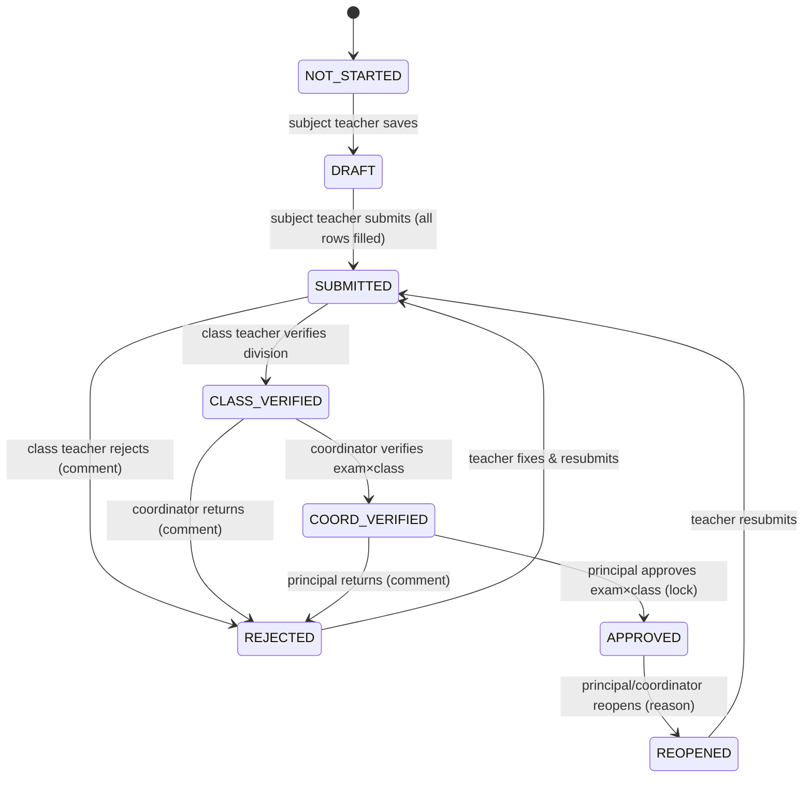

# 04 — Business Rules

Covers **deliverables 4 (roles & permission matrix), 9 (attendance rules), 10 (examination configuration model), 11 (marks & grading), 12 (verification workflow), 13 (dynamic report-card logic)**.
Every rule marked ⚙ is a **policy** (scoped, editable in School Settings → Policies). The default shown is what the school's files indicate. ❓ marks values that need school confirmation (see `06-roadmap-risks-questions.md`).

---

## 1. Roles and permission matrix (deliverable 4)

### 1.1 Data scopes
A role grants *what* a user can do. The **scope** limits *which records*:

| Scope | Meaning |
|---|---|
| SCHOOL | everything in the school |
| MEDIUM | one medium (e.g. a Hindi-medium supervisor) |
| CLASS / SECTION | a specific class or division |
| ASSIGNED | derived from `teaching_assignments` for the current year: subject teachers see their (division, subject) pairs, class teachers their division, attendance teachers their attendance divisions |

The effective scope is the union over a user's roles. It is evaluated server-side in `ScopeService` on every query.

### 1.2 Permission codes (seeded; roles are editable)

Legend: ✅ full · 👁 read-only · 🔹 within ASSIGNED scope · — none

| Permission | Super Admin | School Admin | Principal | Exam Coord. | Class Teacher | Subject Teacher | Attendance Teacher | Office Staff |
|---|---|---|---|---|---|---|---|---|
| `settings.manage` (school, years, mediums, policies) | ✅ | ✅ | 👁 | 👁 | — | — | — | — |
| `academics.manage` (classes, subjects, grading) | ✅ | ✅ | 👁 | 👁 | 👁 | 👁 | — | 👁 |
| `staff.manage` / `assignments.manage` | ✅ | ✅ | 👁 | 👁 (assignments) | — | — | — | 👁 |
| `users.manage` / `roles.manage` | ✅ | ✅ (not Super Admin) | — | — | — | — | — | — |
| `students.read` | ✅ | ✅ | ✅ | ✅ | 🔹 | 🔹 (names, roll, exam no only) | 🔹 | ✅ |
| `students.write` (admit/edit) | ✅ | ✅ | — | — | 🔹 (contact fields) | — | — | ✅ |
| `students.sensitive.read` (Aadhaar, caste) | ✅ | ✅ | ✅ | — | — | — | — | ✅ |
| `students.status` (withdraw/transfer/reactivate) | ✅ | ✅ | ✅ | — | — | — | — | request only |
| `students.promote` | ✅ | ✅ | ✅ | — | — | — | — | — |
| `certificates.issue` / `.cancel` | ✅ | ✅ | ✅ / ✅ | — | — | — | — | ✅ / — |
| `attendance.mark` | ✅ | ✅ | — | — | 🔹 | — | 🔹 | — |
| `attendance.correct.request` | ✅ | ✅ | — | — | 🔹 | — | 🔹 | — |
| `attendance.correct.approve` | ✅ | ✅ | ✅ | — | — | — | — | — |
| `attendance.calendar.manage` | ✅ | ✅ | 👁 | 👁 | 👁 | 👁 | 👁 | 👁 |
| `attendance.legacy.import` / `.approve` | ✅ | ✅ / — | — / ✅ | — | — | — | — | ✅ / — |
| `exams.manage` | ✅ | ✅ | 👁 | ✅ | 👁 | 👁 | — | — |
| `marks.enter` | ✅ | — | — | — | 🔹 (if also subject teacher) | 🔹 | — | — |
| `marks.read` | ✅ | ✅ | ✅ | ✅ | 🔹 (whole division) | 🔹 | — | — |
| `marks.verify.class` | ✅ | — | — | — | 🔹 | — | — | — |
| `marks.verify.coordinator` | ✅ | — | — | ✅ | — | — | — | — |
| `marks.approve` (final) | ✅ | — | ✅ | — | — | — | — | — |
| `marks.reopen` | ✅ | — | ✅ | ✅ (to coordinator stage only) | — | — | — | — |
| `remarks.enter` | ✅ | — | ✅ (principal remark) | — | 🔹 | — | — | — |
| `reportcards.generate` (preview/draft) | ✅ | ✅ | ✅ | ✅ | 🔹 | — | — | ✅ (print) |
| `reportcards.publish` / `.revoke` | ✅ | — | ✅ | — | — | — | — | — |
| `templates.manage` | ✅ | ✅ | 👁 | ✅ | — | — | — | — |
| `reports.view` | ✅ | ✅ | ✅ | ✅ | 🔹 | 🔹 | 🔹 (attendance) | ✅ (student lists) |
| `imports.run` (by type) | ✅ | ✅ | — | marks, exams | 🔹 attendance | 🔹 marks | 🔹 attendance | students, attendance |
| `exports.run` | ✅ | ✅ | ✅ | ✅ | 🔹 | 🔹 | 🔹 | ✅ |
| `migration.historical` | ✅ | — | — | — | — | — | — | — |
| `audit.read` | ✅ | ✅ | ✅ | — | — | — | — | — |
| `dataquality.manage` | ✅ | ✅ | — | — | — | — | — | ✅ |

Notes:
- A user may hold several roles. A typical teacher here is **Class Teacher of X-A + Subject Teacher of English in IX-A, X-A**; permissions merge.
- **Separation of duties:** the same user cannot both submit and final-approve the same mark sheet (enforced in `WorkflowService`), except Super Admin with a logged override reason.
- Parent role is reserved (no permissions in v1).

---

## 2. Attendance calculation rules (deliverable 9)

### 2.1 Working day
For a division *S* on date *d*, `isWorkingDay(S, d)` is true when **all** of these hold:
1. `d` lies within the academic year, and
2. `d` is not a weekly off ⚙ (`academic_years.weekly_off_days`; default Sunday only ❓ 2nd/4th Saturdays), and
3. no HOLIDAY / VACATION / EXAM_HOLIDAY event covers `d` for *S*'s scope,

**OR** a SPECIAL_WORKING_DAY event covers `d` for *S*'s scope (this overrides 2 and 3).

Event scope matching: an event applies when each of its non-null scope fields (medium, standard, section) matches. **The most specific event wins.** A section-level special working day beats a school-level holiday.

### 2.2 Per-student working days
`workingDays(student, month)` = working days of their division in that month, restricted to `[enrollment.joined_on, enrollment.left_on]` ⚙ `attendance.count_from_join_date` (default **true**: a student admitted on 15 July is not marked absent for 1–14 July). Division transfers mid-year split the month by `enrollment_section_changes.effective_date`.

### 2.3 Day value by status ⚙

| Status | Present value | Absent value | Default policy key |
|---|---|---|---|
| P Present | 1 | 0 | — |
| A Absent | 0 | 1 | — |
| H Half day | **0.5** | 0.5 | `attendance.half_day_weight` = 0.5 ❓ |
| L Leave | 0 | 1 | `attendance.leave_mode` = `COUNT_AS_ABSENT` ❓ (alternatives: `EXCLUDE_FROM_WORKING_DAYS`, `COUNT_AS_PRESENT`) |

Leave days are always **shown separately** on reports, whatever the policy.

### 2.4 Monthly figures (per student, per month)

```
working = workingDays(student, month)          // or legacy summary.working_days
present = Σ presentValue(record)               // or legacy summary.present_days
absent  = working − present                    // (leave per leave_mode)
percent = round2(present / working × 100)      // working = 0 → "—", not 100 %
```

### 2.5 Source precedence (mid-year migration)
For each (enrollment, month):
1. If **approved** `attendance_monthly_summaries` exist for that month → use them (the school's June–Oct 2026 data).
2. Else use daily `attendance_records` from **SUBMITTED / VERIFIED / LOCKED** sessions only (drafts never count).
3. A month cannot have both. The importer rejects summaries for months that already contain daily sessions, and daily marking is blocked for months with approved summaries (unless an admin deletes the draft summary first).
4. **Unmarked working days** (no submitted session) are reported as *"not recorded"*. They are not counted as present or absent, and a report-card readiness check flags them.

### 2.6 Period aggregates
Term or year figures = **sum of monthly working and present values**. They are never an average of percentages. Percent is recomputed from the sums.

### 2.7 Low attendance
⚙ `attendance.low_threshold_percent` = **75** (confirmed by the school's pink highlighting). Applied to the cumulative percentage up to the report date.

### 2.8 Corrections
- A teacher can edit a **DRAFT** or own **SUBMITTED** session until ⚙ `attendance.edit_window_hours` (default 24 h / same day).
- After that, or once VERIFIED/LOCKED: a correction request (old → new, reason) → approver → applied with an audit entry and an `attendance_corrections` row.
- Months included in a **published** report card are locked. Changing them requires a correction plus a report-card republish (new version; the old one is superseded, not deleted).

---

## 3. Examination configuration model (deliverable 10)

```
Examination (year, medium, code, kind, term, dates, status)        e.g. UT1, SEM1, UT2, SEM2
 └─ ExamClass (exam × class, applicable divisions, workflow status) e.g. SEM1 × EN-VIII
     └─ ExamSubject (class_subject, date, max, pass, grading)      e.g. English, max 100
         └─ ExamComponent (code, label, max, pass, ENTERED|DERIVED) e.g. FORM 40 · SUM 60
             └─ MarkSheet (per division)  → Marks (per student per component)
```

### 3.1 Seed configuration for this school (from the files, editable)

| Exam | Kind | Components per scholastic subject | Co-scholastic (Work Exp., Art, PE) | Shown on report card |
|---|---|---|---|---|
| UT1, UT2 (Std X shown) | UNIT_TEST | Single component, max 20 | — ❓ | ❓ (not on current card) |
| Semester I | SEMESTER | FORM-I 40 + SUM-I 60 = 100 | FORM-I 100 (no SUM) | ✅ |
| Semester II | SEMESTER | FORM-II 40 + SUM-II 60 = 100 | FORM-II 100 | ✅ |

**Derived components:** if the school confirms that Formative = UT1 + UT2 (20 + 20 = 40), then `FORM-I.entry_mode = DERIVED` with `{"op":"SUM","sources":[UT1,UT2]}`. The value is computed from approved UT marks and is read-only in the grid. Other formulas are supported: `SUM`, `AVERAGE`, `BEST_OF(n)`, `SCALE_TO(max)`, `WEIGHTED`.

**Std X papers:** Algebra and Geometry are papers under Mathematics; Sci-I and Sci-II under Science; His. & P.S. and Geography under Social Science. Marks are entered per paper. `class_subjects.report_rollup` decides whether the report card shows papers, the parent sum, or both ❓.

### 3.2 Exam lifecycle (per ExamClass)

```mermaid
stateDiagram-v2
  [*] --> DRAFT
  DRAFT --> SCHEDULED: schedule (subjects, max marks complete)
  SCHEDULED --> CONDUCTED: mark conducted (on/after end date)
  CONDUCTED --> MARKS_ENTRY: auto when first sheet saved
  MARKS_ENTRY --> SUBMITTED_FOR_VERIFICATION: all sheets submitted
  SUBMITTED_FOR_VERIFICATION --> VERIFIED: all divisions class-verified + coordinator verified
  VERIFIED --> APPROVED: principal approves (locks all sheets)
  APPROVED --> PUBLISHED: report card published
  VERIFIED --> MARKS_ENTRY: any sheet rejected
  APPROVED --> MARKS_ENTRY: reopen (reason required)
  PUBLISHED --> MARKS_ENTRY: reopen after publication (principal, reason; publication superseded on republish)
```



Structural edits (max marks, components) are allowed only in DRAFT/SCHEDULED. After that, a change requires reopening to DRAFT, which is only possible while **no marks exist**.

---

## 4. Marks calculation and grading rules (deliverable 11)

### 4.1 Validation at entry
- `0 ≤ marks ≤ component.max_marks`. Negative values are not allowed (⚙ `marks.allow_negative` = false).
- Decimal places ⚙ `marks.decimals` = 0 (half marks allowed if set to 1).
- Status codes: **AB** absent, **EX** exempted, **NA** not applicable (optional subject not chosen), **ML** medical. Status and number are mutually exclusive.
- The student must be enrolled in the sheet's division on the exam date. An optional subject is enterable only if chosen.
- Saving is refused if the sheet is not in DRAFT/REJECTED/REOPENED, or the user is not assigned (`409`/`403`).
- **Submission requires every row filled** (a number or a status). Blank cells block submission.

### 4.2 Subject result (per exam column)
```
subjectTotal  = Σ component marks (+ grace marks, shown with *)
subjectMax    = Σ component max
subjectPct    = subjectTotal / subjectMax × 100
subjectGrade  = band(subjectPct, grading_system)            // bands inclusive of lower bound
subjectPass   = subjectTotal ≥ pass_marks  (default ⚙ result.pass_percent_subject = 35 % of max)
```
**Component-level pass** ⚙ `result.require_component_pass` (default false).

### 4.3 Absent / exempt handling ⚙ `marks.absent_policy`

| Policy | Effect |
|---|---|
| `SHOW_AB_INCOMPLETE` **(default)** | Shows "AB". The subject is excluded from computed totals and the overall result is **INCOMPLETE** until resolved. Matches the school's current `%` = "–" for the absent student |
| `ZERO` | AB counts as 0 in totals (the cell still shows "AB") |
| `EXCLUDE` | The subject is dropped from both obtained and max (like exempt) |

**EX / NA** always remove the subject from obtained **and** max totals.

### 4.4 Aggregate columns (e.g. "Average")
`aggregate = op(input column subject totals)`, rounding ⚙ `result.aggregate_rounding` = **HALF_UP_INT** (verified: (92+63)/2 = 77.5 → 78).
Ops: `AVERAGE`, `SUM`, `WEIGHTED` (weights per input), `BEST_OF`.

### 4.5 Overall (per column)
```
totalObtained = Σ subjectTotal over subjects with include_in_total
totalMax      = Σ subjectMax   (same subjects)
percentage    = round2(totalObtained / totalMax × 100)     // 786/900 = 87.33 ✔
overallGrade  = band(percentage)
result        = PASS if every compulsory subject passes (⚙ result.rule = ALL_SUBJECTS_PASS)
                and percentage ≥ ⚙ result.pass_percent_overall (default 35)
                FAIL otherwise; INCOMPLETE if any AB under SHOW_AB_INCOMPLETE
```
The *final* result, percentage and grade printed in the result block come from the scheme column with `is_final = true` (e.g. Average). Before that column is visible, they come from the latest visible column ❓.

### 4.6 Grading system seed — Maharashtra CCE 9-point

| Grade | % range | Status |
|---|---|---|
| A1 | 91–100 | verified on card |
| A2 | 81–90 | verified |
| B1 | 71–80 | verified |
| B2 | 61–70 | verified |
| C1 | 51–60 | assumed ❓ |
| C2 | 41–50 | assumed ❓ |
| D | 33–40 | assumed ❓ |
| E1 | 21–32 | assumed ❓ |
| E2 | 0–20 | assumed ❓ |

Band lookup uses the **unrounded** percentage against lower bounds (≥ 91 → A1; 90.4 → A2).

### 4.7 Rank ⚙ `result.rank_mode` = `OFF` (alternatives: `COMPETITION` 1,2,2,4 / `DENSE` 1,2,2,3). Students with INCOMPLETE/FAIL are unranked.

### 4.8 Grace marks ⚙ `result.grace_enabled` = false. If enabled: per-subject cap, needs the `marks.approve` permission, is shown with `*`, and is audited.

---

## 5. Teacher verification workflow (deliverable 12)

> **Superseded** by [07-academic-approval-workflow.md](07-academic-approval-workflow.md): Operator → Subject Teacher → Class Teacher → Headmaster (coordinator optional). The table below is kept for the coordinator-stage details.



| Step | Actor | Unit | Checks shown to the actor before acting |
|---|---|---|---|
| 1 Submit | Subject teacher | mark sheet (exam-subject × division) | All rows filled; out-of-range = 0; count of AB/EX |
| 2 Class verify | Class teacher | division × exam (`section_exam_reviews`) | All subject sheets of the division submitted; student list matches enrollment; attendance for the term has no unrecorded days; remarks entered. **Consolidated marksheet** view (the school's paper format), including printing for student signatures |
| 3 Coordinator verify | Exam coordinator | exam × class | Every division verified; no missing sheets; every subject has an assigned teacher; outlier flags (e.g. sheet average jump > 25 points vs previous exam, all-same marks) |
| 4 Final approve | Principal | exam × class | Summary: pass %, AB count, grade distribution. Approval **locks** all sheets (`is_locked = true`) |

Rules:
- Rejection always needs a comment and targets **specific mark sheets**. Other sheets keep their status.
- ⚙ `workflow.stages` lets the school drop the coordinator stage (e.g. `[SUBMIT, CLASS_VERIFY, APPROVE]`) without code changes ❓.
- Every transition writes `workflow_actions` (who, when, from → to, comment) and notifies the next actor (in-app).
- **Reopen** requires a reason, is audited, and moves the exam back to MARKS_ENTRY. If already published, the publication becomes `SUPERSEDED` when a new one is published. Old PDFs stay downloadable and are marked "superseded".
- Changes to marks after the first submission are recorded in `mark_revisions`, and the approver sees a diff.
- **Attendance verification:** class teacher submits daily sessions; month-end "verify month" by the class teacher locks them (`VERIFIED`). Legacy monthly summaries need `attendance.legacy.approve`.

---

## 6. Dynamic report-card generation logic (deliverable 13)

### 6.1 Inputs
`publication(class, division?, scheme, templateVersion, issueDate)` → for each active enrollment in scope.

### 6.2 Column visibility (the core rule)
```ts
function visibleColumns(scheme, examClassStatus): Column[] {
  const visible = new Set<string>();
  for (const col of scheme.columns.sortBy('sort_order')) {
    if (col.type === 'EXAM') {
      // only conducted AND approved/published exams
      if (['APPROVED', 'PUBLISHED'].includes(examClassStatus[col.examinationId])) visible.add(col.key);
    } else { // AGGREGATE
      const inputs = col.aggregate.inputs;
      const ok = col.aggregate.requireAllInputs
        ? inputs.every(k => visible.has(k))
        : inputs.some(k => visible.has(k));
      if (ok) visible.add(col.key);
    }
  }
  return scheme.columns.filter(c => visible.has(c.key));
}
```
- Exams in DRAFT/SCHEDULED/CONDUCTED/MARKS_ENTRY/SUBMITTED/VERIFIED → **no column**, never blank or zero.
- **Unapproved marks are never read.** The marks query joins `mark_sheets.status = 'APPROVED'` (or the exam class `PUBLISHED`), so this is enforced at the data-access layer as well as by the column rule.
- Default `requireAllInputs = true` for Average: after Semester I only, the card shows only Semester I columns ❓.

### 6.3 Rows
Subject rows = `class_subjects` of the student's class (medium-specific by construction), ordered by `display_order`:
- optional subjects only if chosen (`enrollment_subjects`);
- papers shown per `report_rollup` (paper rows, parent row = sum, or both);
- a subject with no component in any visible column is hidden ⚙;
- co-scholastic subjects (`area = CO_SCHOLASTIC`) show "--" for missing components (e.g. Work Exp. has no Summative), matching the current card.

### 6.4 Cells
Per (subject, column): component values (if `show_components`), total, grade, using §4. Status display: `AB`, `EX`, `--` (component not applicable), `*` grace.

### 6.5 Attendance block (bottom of card)
Template option `attendance.mode` (**school confirmed: MONTHLY**):
- `MONTHLY` (the brief's requirement): one row per month from year start to the issue month, using **working, present and absent** values from §2. Only months with working days > 0 appear; future months never do. A total row follows.
- `BY_TERM` (the school's current card): Semester I / Semester II / Total.
- `BOTH`: a compact monthly table plus a term summary.

### 6.6 Readiness checks (block publication if any fail)
1. Every EXAM column to be shown is APPROVED for the class.
2. No unrecorded attendance working days up to the issue date (or an explicit override with a reason).
3. Legacy attendance summaries for the months used are APPROVED.
4. Remarks/conduct entered if the template has those sections (warning only ⚙).
5. Template version is valid for the class's medium/standard.

### 6.7 Publication
1. `results.compute` builds `student_results.detail` (all numbers, labels, attendance, remarks), a **frozen snapshot**.
2. `report_cards` rows get `verification_code`; PDFs are rendered in the background (HTML template + snapshot → Chromium → PDF).
3. Status `PUBLISHED`; exam classes involved → `PUBLISHED`.
4. Reprints always use the snapshot and template version, so a 2026 card reprinted in 2030 is byte-for-byte the same content.
5. Republishing creates a new publication (`supersedes_id`). The old one becomes `SUPERSEDED` (still visible in history).

### 6.8 Template sections (designer)
`header` (logo, name, address, motto, medium line, year line) · `title` · `student_info` (field picker: name, Std, Div, Exam No, GR No, DOB, roll, parents, photo) · `marks_table` (column groups from the scheme; label overrides such as "Form-I/Sum-I") · `totals_row` · `attendance` (mode) · `result_block` (result, %, grade, progress, conduct, re-opening date) · `remarks` · `co_curricular` · `signatures` (class teacher / principal / parent; image or blank line; stamp) · `footer` (issue date, QR). Global: page size (A4/A5/Letter), orientation, margins, base font size, font families (Latin + Devanagari), bilingual labels (EN / HI / EN+HI).
