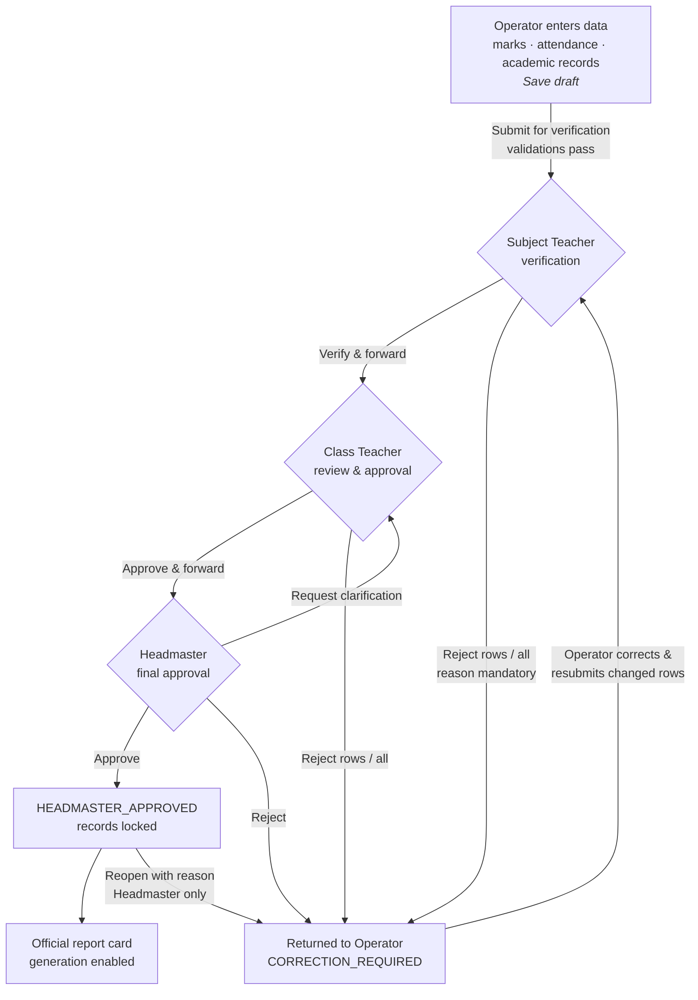

# 07 — Operators, Academic Assignments and Multi-Level Approval Workflow

Status: **built**: roles, assignments, submissions (`academic_submissions`), row-level states on `marks` / `attendance_monthly` (passed stage + verified hash), `verification_actions`, partial rejection, Headmaster reopen, separation of duties, the report-card gate, and the Approvals page / task counts. Not built yet: the optional exam-coordinator stage, due-date escalation, and a stored notification inbox (pending work is computed live). This document is the agreed design for that work. It supersedes the 4-stage marks workflow in `04-business-rules.md` §5.

---

## 1. The workflow



- **Corrections always go back through every stage** that sits after the Operator. There is no shortcut from a Class Teacher or Headmaster rejection straight back to the rejecting stage.
- **Optional extra stage:** the exam-coordinator check sits before the Headmaster (policy `workflow.stages`). The three mandatory stages cannot be switched off, and the API refuses such a setting.
- **Attendance** follows the same engine. The verifier is the division's **Attendance Verifier** if one is assigned, otherwise its **Class Teacher**. It then goes to Class Teacher approval (merged when it is the same person) and Headmaster approval.
- **Student information** edited by Operators (academic fields such as roll no. and remarks) follows the same engine with the Class Teacher as first verifier. Master data (admission, GR no.) stays with Office/Admin staff.

## 2. Roles (built, see `packages/shared/src/permissions.ts`)

| Role | Scope | Does | Can never |
|---|---|---|---|
| **Headmaster** | whole school | sees everything; manages all academic assignments; final approval; publishes report cards; reopens with reason; school-wide reports | enter data as operator (separation of duties) |
| **Operator** | assigned divisions | enters / updates marks, attendance and academic records; drafts; submits; corrects rejected rows | verify, approve, publish, see unassigned divisions |
| **Subject Teacher** | assigned (division, subject) pairs | verifies that subject's submissions row by row; rejects with reason | enter data in the verification view; verify other subjects |
| **Class Teacher** | assigned division | reviews completeness (all subjects, attendance, remarks); approves or rejects | approve other divisions; bypass subject verification |
| **Attendance Verifier** *(optional assignment)* | assigned divisions | verifies attendance | — |
| **Exam Coordinator** *(optional stage)* | school | configures exams; optional check | final approval |
| **School Admin / Office** | school | setup, students master data, logins (may create Operator logins) | grant approval powers they don't hold |
| **Super Admin** | school | technical administration, all logins and roles | **has no academic approval permission by default**; cannot change own roles |

**Multiple roles:** one person may be, for example, Operator of 5-A and Subject Teacher of Maths in 5-A. Each action is checked against **the role it needs and that role's assignment** (`ScopeService.assertAssigned`). The workflow also enforces **"never verify or approve a submission you entered"**, whatever roles you hold.

### Data visibility (enforced by the API, not by hiding links)

| Data | Operator | Subject Teacher | Class Teacher | Headmaster |
|---|---|---|---|---|
| Student list & details | assigned divisions | assigned divisions | assigned division | all |
| Attendance | assigned divisions | if Attendance Verifier there | assigned division | all |
| Marks | assigned divisions (entry) | assigned subjects | assigned division | all |
| Subject / class performance | — | assigned subjects | assigned division | all |
| Verification status, rejection history | own submissions | assigned verifications | assigned division | all |
| School-wide reports (`reports.schoolwide`) | — | — | — | ✔ |
| Assignments (`assignments.manage`) | — | — | — | ✔ |
| Final approval / publish | — | — | — | ✔ |

Changing an id in a URL or request body can't widen this. Every query filters by the resolved scope, and every action calls `assertAssigned`. (Phase 1 e2e tests already cover the scope checks for operators and teachers.)

## 3. Database changes

### 3.1 Built in Phase 1
| Change | Purpose |
|---|---|
| `teaching_assignments.role` ∈ `OPERATOR, SUBJECT_TEACHER, CLASS_TEACHER, ATTENDANCE_VERIFIER` (DB CHECK) | One assignment table for all academic assignments, per academic year and division. It replaces the separate `operator_/class_teacher_/subject_teacher_/verifier_assignments` tables in the brief, which would have duplicated the same columns |
| `ux_ta_one_class_teacher` functional unique index | One active class teacher per division |
| `ux_ta_active` functional unique index | No duplicate active assignment; **many operators per division allowed** |
| Assignments are ended, never deleted (`status`, `valid_from/valid_to`) + audit with reason | Assignment history; "replace" hands over atomically |
| Roles `HEADMASTER`, `OPERATOR`; permissions `marks.verify.subject`, `attendance.verify`, `students.academic.entry`, `reports.schoolwide` | Role model above |

### 3.2 Phase 4–5 tables (designed)
```
academic_submissions            one unit of work, e.g. "UT1 · EN-X-A · Mathematics · marks"
  id, academic_year_id, section_id, record_type (MARKS|ATTENDANCE|STUDENT_ACADEMIC|REMARKS),
  examination_id NULL, class_subject_id NULL, period (e.g. '2026-11' for attendance) NULL,
  current_stage (OPERATOR|SUBJECT_VERIFY|CLASS_APPROVE|COORDINATOR_VERIFY|HEADMASTER_APPROVE|DONE),
  status (DRAFT|SUBMITTED|IN_REVIEW|CORRECTION_REQUIRED|HEADMASTER_APPROVED|REOPENED),
  revision INT, submitted_by, submitted_at, final_approved_by, final_approved_at, version
  UNIQUE (record_type, section_id, examination_id, class_subject_id, period)

academic_submission_records     one row per student in the submission (enables PARTIAL rejection)
  id, submission_id, enrollment_id, entity_type, entity_id (mark / attendance row),
  row_status (PENDING|VERIFIED|REJECTED|CORRECTED), last_stage_passed, revision,
  rejected_reason NULL, data_hash  -- hash of values at last verification; any edit resets the row
  UNIQUE (submission_id, enrollment_id, entity_type, entity_id)

verification_actions            append-only log of every decision
  id, submission_id, record_id NULL (NULL = whole submission), stage, actor_user_id, actor_role,
  action (SUBMIT|VERIFY|APPROVE|REJECT|REQUEST_CLARIFICATION|REOPEN|RESUBMIT|REASSIGN),
  from_status, to_status, comment, created_at

record_revisions                old → new values for every change after first submission
  id, record_type, record_id, submission_id, revision, old_value JSON, new_value JSON, changed_by, reason, created_at

user_tasks                      what is waiting for whom
  id, user_id, submission_id, stage, status (OPEN|DONE|REASSIGNED|CANCELLED), due_date NULL,
  created_at, closed_at, reassigned_to_task_id NULL

user_notifications              in-app inbox
  id, user_id, kind, title, body, link, submission_id NULL, read_at NULL, created_at
```
**Who gets the task** is resolved from `teaching_assignments` at the moment the submission reaches a stage. If an assignment later changes, open tasks are **not** moved silently. The Headmaster sees them under "Tasks of replaced staff" and reassigns explicitly (`REASSIGN` action, audited).

The brief's `approval_history`, `rejection_history` and `verification_steps` are covered by `verification_actions` (one ordered, append-only log). `verification_workflows` is covered by the `workflow.stages` policy plus a code-defined state machine.

## 4. Workflow engine (Phase 5)

A single `WorkflowService` owns every status change. Controllers never set statuses themselves.

```ts
transition(ctx, submissionId, action, { recordIds?, comment }) {
  // inside one DB transaction, SELECT … FOR UPDATE on the submission
  1. load submission + stage config (policy workflow.stages)
  2. allowed = STATE_MACHINE[current_stage][action]          // else 409 INVALID_STATE
  3. permission for the stage (marks.verify.subject …)        // else 403
  4. assignment for the stage (ScopeService.assertAssigned)   // else 403 OUT_OF_SCOPE
  5. separation of duties: actor ≠ submitted_by / any operator who edited rows in this revision
  6. REJECT ⇒ comment required; rows → REJECTED; submission → CORRECTION_REQUIRED (stage OPERATOR)
     VERIFY/APPROVE ⇒ every mandatory row VERIFIED at this stage, else 409 (“3 rows still rejected”)
  7. write verification_actions, close/open user_tasks, notify next actor, audit
}
```

**Partial rejection rules:**
- A verifier can reject individual student rows. The submission returns to the Operator **with only those rows editable**.
- Rows that are not touched keep their verification history. **Any edited row** (detected by `data_hash`) goes back to `PENDING` and must pass **every** stage again, starting with the Subject Teacher.
- The submission advances only when **all** mandatory rows are verified at the current stage.
- **Two operators** on the same division can work in parallel. Rows are saved individually with optimistic locking (`version`), so neither silently overwrites the other. A conflict shows "changed by Operator B at 10:42 — reload".

**Report-card gate (Phase 6):** an official card can be generated only when every required submission for that student's class and exam (all subjects' marks + attendance months + remarks) is `HEADMASTER_APPROVED`. Generation reads the **approved revision snapshot**, never live rows. Card statuses: Draft → Data entry in progress → Pending subject verification → Pending class teacher → Pending Headmaster → Rejected–correction required → Headmaster approved → Generated → Published. Authorised users get a **preview watermarked "DRAFT / NOT APPROVED"**.

## 5. Notifications (Phase 5)
| Event | Notified |
|---|---|
| Operator submits | assigned Subject Teacher (or Attendance Verifier) |
| Subject Teacher verifies | Class Teacher |
| Any rejection | the submitting Operator **and** the division's current operators (with the reason) |
| Class Teacher approves | Headmaster |
| Headmaster approves | Operator, Subject Teacher(s), Class Teacher; report-card generation enabled |
| Assignment replaced with open tasks | Headmaster ("tasks need reassignment") |

There is an in-app bell with unread/read, timestamps, deep links and pending-task counts, plus due dates from the exam's `marks_due_date`. WhatsApp/SMS later reuses the same events through the outbox (`02-architecture.md` §9).

## 6. Screens

**Built now**
- **Academic Assignments** (`/academics/assignments`), with three tabs:
  - *Subject & class teachers*: a matrix with divisions as columns and class teacher / attendance verifier / subjects as rows. Changing a person performs an audited **replace**.
  - *Operators*: a table (operator · medium · class · division · from · status) with medium filter and include-ended toggle. **Assign operator** opens a multi-division picker across both mediums; each row has Replace (reason required) and Remove.
  - *History*: who changed what, when and why.
- Users: role grants with scope (Operators use "Assigned classes only").
- Dashboard: setup checklist now includes "divisions without an operator", plus "My responsibilities" for every staff user.

**Phase 4–5 wireframes**

```
OPERATOR DASHBOARD                               SUBJECT TEACHER — VERIFY MARKS (UT1 · EN-X-A · Mathematics)
┌ My divisions: EN-X-A · HI-X-A ┐                ┌──────────────────────────────────────────────────────────┐
│ Drafts 2 │ Submitted 3 │ Rejected 1 (!) │      │ Roll Name                    Max  Marks  Status   ☐      │
│ Correction required ▸ UT1 Maths X-A (3 rows) │ │  1  CHAURASIYA PRATIMA…       20   13     ✓        ☐      │
│ [Enter marks] [Enter attendance] [Rejected]  │ │  7  ANSARI RABIYA…            20   11     ✓        ☑      │
└──────────────────────────────────────────────┘ │ …                                                         │
                                                 │ Reason for selected rows: [ wrong marks for roll 7 ]      │
CLASS TEACHER — REVIEW EN-X-A · UT1              │ [Reject selected → Operator]  [Verify & forward → CT]     │
┌ Subjects 9 · verified 7 · pending 2 ┐          └──────────────────────────────────────────────────────────┘
│ Attendance Nov: complete ✓  Remarks: 18/21 ⚠ │
│ [Consolidated marksheet]  [Approve → HM] [Reject rows] │   HEADMASTER — FINAL APPROVAL QUEUE
└──────────────────────────────────────────────┘           │ Class · exam · submitted by · ST ✓ by · CT ✓ by · age │
                                                           │ [Open] → full trail · [Approve] [Reject] [Clarify]   │
```

Role dashboards have the cards and quick actions listed in the requirement, each backed by real counts from `academic_submissions` / `user_tasks`.

## 7. Acceptance scenarios (Phase 5 e2e tests)

| # | Scenario | Expected |
|---|---|---|
| 1 | Happy path O → ST → CT → HM | `HEADMASTER_APPROVED`; report card generation allowed |
| 2 | ST rejects | O sees reason; fix; ST again → CT → HM |
| 3 | CT rejects a row ST had verified | row back to O; after fix **ST must re-verify** before CT |
| 4 | HM rejects | restarts at ST |
| 5 | Operator of Class 5 calls Class 6 APIs | 403 OUT_OF_SCOPE (Phase 1 covers the scope mechanism) |
| 6 | Two operators edit the same division | different rows saved; same row → 409 with reload hint |
| 7 | Maths teacher verifies English | 403 |
| 8 | Everything entered but HM not approved | official generation 409; draft preview watermarked |
| 9 | Reject 3 of 40 rows | 37 keep VERIFIED with history; 3 re-run all stages |
| 10 | Operator / teacher replaced mid-review | history intact; open tasks listed for HM reassignment |
| + | Same person is operator and subject teacher | cannot verify own entry |
| + | Super Admin tries to approve | 403 (no approval permission) |

Phase 1 already proves: role model, Super Admin without approval rights, no self role changes, operator scoping per role, many-operators-per-division, replace with mandatory reason, assignment history.

## 8. Extra improvements included in this design
1. **Row-level hashing** (`data_hash`): partial rejection is safe because *any* change resets verification, even edits to rows that weren't rejected.
2. **Separation-of-duties check by data, not by role**: it blocks anyone who touched a row in the current revision from verifying it, which closes the multi-role loophole.
3. **"Request clarification"** (HM → CT) without discarding verified work.
4. **Due dates and escalation**: tasks overdue by N days appear in red on the Headmaster dashboard.
5. **Reassignment queue** instead of silent transfer when staff change.
6. **Consolidated marksheet** inside the Class Teacher review, matching the school's existing signature sheet.
7. **Approved snapshot per revision** feeds report cards, so later edits can never leak into a published card.
